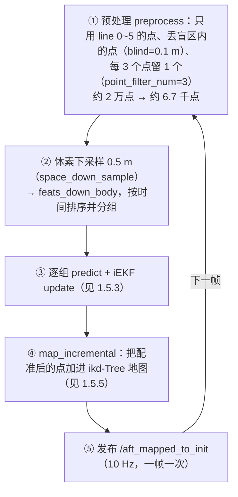
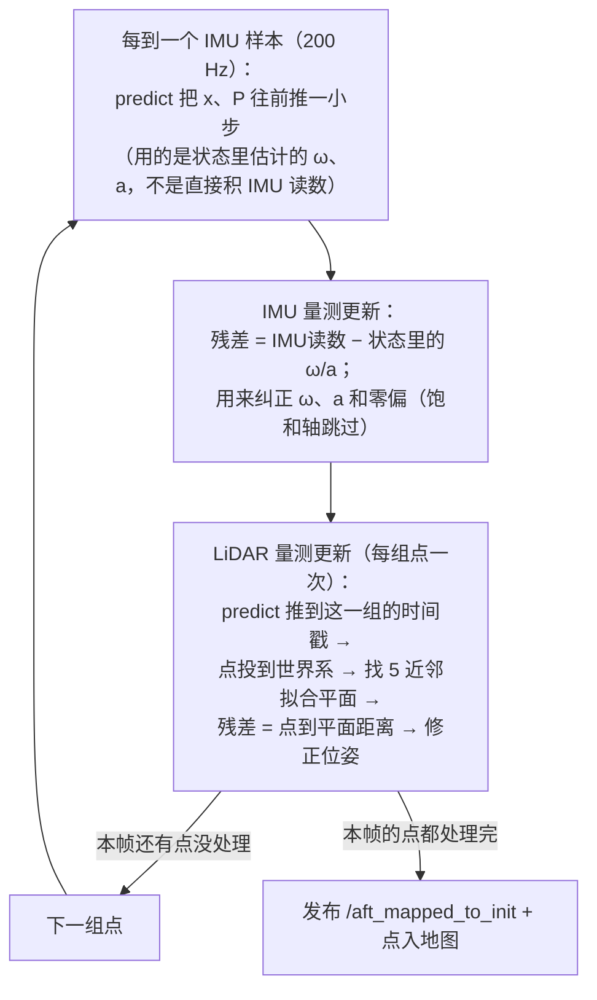
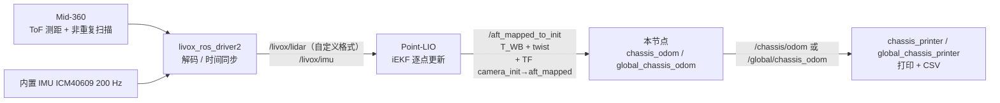
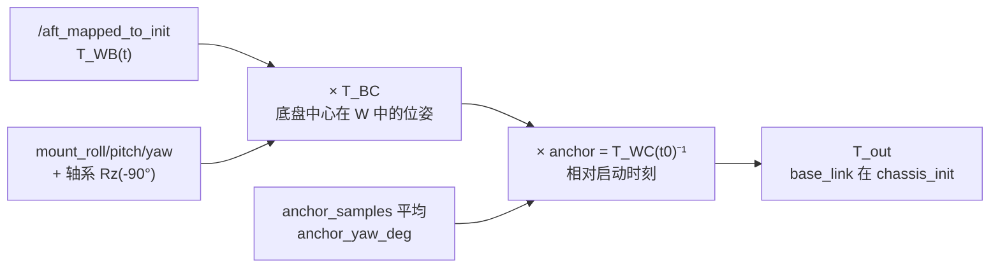
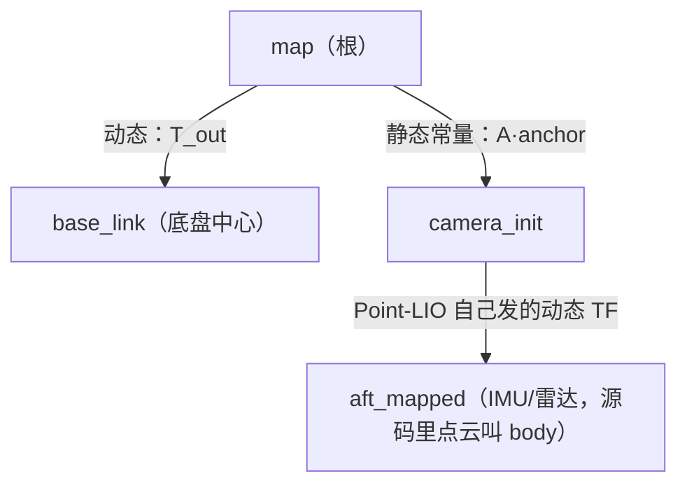

> **怎么读这份文档**
>
> - 想搞清"**Point-LIO + Mid-360 到底怎么定位的**" → 读 **第一章**（1.5 是核心：IMU 猜 → 雷达纠正 → 地图自己长）
> - 只想知道"参数怎么调" → 直接跳到 **第零章 0.6 的公式速查** + **第三、四章（测试与标定）**
> - 想自己推一遍"为什么要这么乘" → 从第零章开始，按顺序读
> - 想知道"`/aft_mapped_to_init` 里的数是怎么算出来的" → 读 **第一章 1.5**

---

定位链路一共三个终端，缺一不可（数据流见 1.6）：

```Shell
# ① 雷达驱动：发 /livox/lidar（10 Hz，自定义点云格式）+ /livox/imu（200 Hz）
source ~/livox_ws/install/setup.bash
ros2 launch livox_ros_driver2 msg_MID360_launch.py

# ② Point-LIO：吃上面两个话题，发 /aft_mapped_to_init（10 Hz）+ TF camera_init→aft_mapped
source ~/livox_ws/install/setup.bash
source ~/point_lio/install/setup.bash
ros2 launch point_lio mapping_mid360.launch.py

# ③ 本项目的坐标换算
source ~/livox_ws/install/setup.bash
source ~/point_lio/install/setup.bash
source install/setup.bash
ros2 launch lio_naver global_chassis_odom.launch.py
```

# 零、基础概念：看懂本文需要的 5 件事

如果不熟悉刚体变换，先花 5 分钟看这一章，后面所有公式都能自己推。

## 0.1 坐标系、位姿、坐标

**坐标系** = 一个原点 + 三个互相垂直的单位轴。同一个物理点，在不同的坐标系里量出来的数字不一样。

记号约定（全文统一）：

- $p_A$：物理点 P 在坐标系 A 里的坐标，3×1 向量
- $R_{BA}$：把 A 系的坐标分量转成 B 系的坐标分量的**旋转矩阵**
- $t_{BA}$：A 系原点在 B 系中的**位置**
- $T_{BA}$：上面两个打包成的**齐次变换**

> 📌 **读法：下标从右往左读。** $R_{BA}$ 读作"B←A"，意思是"把 A 的分量换成 B 的分量"。

**位姿（pose）** = 位置 + 朝向。把 A 系的点换算到 B 系：

$$
p_B = R_{BA}\,p_A + t_{BA}
$$

## 0.2 旋转矩阵：只要记住这 3 条

| 性质                                    | 公式                                            | 用途                                           |
| --------------------------------------- | ----------------------------------------------- | ---------------------------------------------- |
| 正交，逆 = 转置                         | $R^{-1}=R^{\mathsf T}$                        | 反向换算不用重新算，转置即可（代价低、数值稳） |
| 行列式为 +1                             | $\det R = +1$                                 | 右手系、不镜像                                 |
| **列 = 源系各轴在目标系中的指向** | $R_{BA}$ 的第 3 列 = A 的 z 轴在 B 系中的分量 | ⭐ 判断"轴系重映射对不对"的全部依据            |

第三条是最实用的：拿到一个旋转矩阵，看它的列，就知道源坐标系的三个轴在目标系里指向哪里。

## 0.3 齐次变换 $T$：把旋转和平移打包

$$
T_{BA}=\begin{bmatrix}R_{BA} & t_{BA}\\ 0\ 0\ 0 & 1\end{bmatrix},
\qquad \tilde p_B = T_{BA}\,\tilde p_A
$$

（$\tilde p$ 是补了 1 的 4×1 齐次坐标）

**两条必须记住的运算规则**：

1. **复合**：$T_{CA} = T_{CB}\,T_{BA}$ —— **中间的下标必须相同**（这里是 B）。链条就是这么接起来的，也是我们能一路连乘的原因。
2. **求逆**（有闭式解，别用 4×4 求逆）：

$$
T_{BA}^{-1}=\begin{bmatrix}R_{BA}^{\mathsf T} & -R_{BA}^{\mathsf T}t_{BA}\\ 0 & 1\end{bmatrix}
$$

⚠️ 常见错误：以为 $T^{-1}$ 就是把 $t$ 取负号。不是，$t$ 要先被转置矩阵旋转再取负。

## 0.4 四元数：ROS 里朝向的实际表示

- 单位四元数 $q$ 与旋转矩阵 $R$ 一一对应，但有个坑：**$q$ 和 $-q$ 是同一个旋转**。
  → 所以代码里对多帧求平均前必须先统一符号（`dot(q_front, qq) < 0` 就取反），否则平均值会算飞到零附近。
- 四元数乘法的语义和矩阵乘法**完全一致**：$q_{1}q_{2}$ 对应的旋转 = **先做 $q_2$，再做 $q_1$**。
  → `q_BC = q_axis * q_mount` 的意思就是：先叠加安装误差 `q_mount`，再套轴系重映射 `q_axis`。
- tf2 里 `tf2::Transform(q, v)` 就是本文的 $T$；`T1 * T2` 就是 $T_1T_2$。

## 0.5 ROS 里的 frame 约定（和本文三个系一一对应）

`nav_msgs/Odometry` 有两个 frame 字段：

| 字段                | 含义                                   | 本项目取值                                                      |
| ------------------- | -------------------------------------- | --------------------------------------------------------------- |
| `header.frame_id` | **父系**，位姿是在这个系里描述的 | `/aft_mapped_to_init` → `camera_init`                      |
| `child_frame_id`  | **子系**，被描述的那个刚体       | `aft_mapped`（Point-LIO 源码默认值）/ `base_link`（本节点） |

也就是：`/aft_mapped_to_init` 就是 $T_{WB}$，`/chassis/odom` 就是 $T_{chassis\_init,\ base\_link}$。

> 📌 `aft_mapped` 这个名字不直观，但它指的就是**雷达壳体内的 IMU 原点**（Point-LIO 源码里点云用的 frame 名是 `body`，odom 用的是 `aft_mapped`，**两者是同一个物理刚体**）。
> 本文为了和公式符号对上，统一把它叫 **body 系 $B$**；如果哪天想改名，改 Point-LIO 的 `odom_child_frame_id` 参数即可。

TF 树上我们的节点在 `camera_init → aft_mapped` 这条链的**下游**，新发一条 `chassis_init → base_link`（或在全局方案里 `map → base_link`）。

> ⚠️ 一个必须知道的例外：REP-103 规定 `twist` 写在 child 系里，**但 Point-LIO 没有遵守**：
> 它的 `twist.linear` 是**世界系**速度，`twist.angular` 才是 body 系。
> 这就是第 5 节要分开换算的原因。

## 0.6 公式速查（背下这三条就够用）

$$
\boxed{\;T_{out}=T_{BC}^{-1}\bigl(T_{WB0}^{-1}T_{WB}\bigr)T_{BC}\;}
$$

$$
\boxed{\;p_{out}=R_{BC}^{\mathsf T}\Bigl[(R_M-I)\,t_{BC}+R_{WB0}^{\mathsf T}\,\Delta p_{WB}\Bigr],
\qquad R_M=R_{WB0}^{\mathsf T}R_{WB}\;}
$$

$$
\boxed{\;\text{纯平移}(R_M=I)\;\Rightarrow\;p_{out}=R_{BC}^{\mathsf T}R_{WB0}^{\mathsf T}\,\Delta p_{WB}\;\text{，}t_{BC}\ \text{消失}\;}
$$

---

# 一、传感器与定位原理：Livox Mid-360 + Point-LIO

Mid-360 通过 ToF 测距和内部旋转棱镜扫描，得到约 2 万点/帧、点为 10 Hz 的点云，这些点与雷达内置 IMU 在 200 Hz 采样且时间戳同源，因此进入驱动后被转换为自定义点云格式发布。Point-LIO 在回调中先做预处理：按 line/tag 过滤，丢弃盲区内的点，每 point_filter_num 个点抽 1 个，并把每个点的 curvature 写成它相对帧头的真实时间戳；接着与 IMU 数据一起进入缓冲区，凑成一组“一帧点云 + 该帧结束前的全部 IMU”数据。开机阶段先用 100 个 IMU 样本（≈0.5 s）估计重力方向和陀螺零偏，再把世界系（camera_init）的 z 轴旋转到与 −g 对齐，x/y 轴继承开机瞬间的 body 朝向，然后用第一帧点云建立初始 ikd-Tree 地图，并且这一帧不发布 odom。之后每帧都走同一套主循环：先做 0.5 m 体素下采样，再按时间戳排序并分组（多数组只有 1 个点）；然后逐组处理——每遇到一个 IMU 样本，就用状态里估计的 ω、a 前推状态与协方差，并用 IMU 读数做一次 6 维量测更新，以纠正 ω、a 和零偏（饱和轴跳过），再把状态前推到该组点自己的时间戳，用当前位姿把点投到世界系，在上一帧为止已有的地图里找 5 个近邻并拟合平面，算出点到平面残差，交给 iEKF 做 Gauss-Newton 更新（本配置迭代 2 次，协方差只在最后一轮收缩）来修正位置、姿态等状态，再用更新后的位姿把该组点重新投到世界系；一帧所有组处理完后，先发布 /aft_mapped_to_init（T_WB + twist，10 Hz）和 camera_init→aft_mapped 的 TF，再把本帧点并入 ikd-Tree 作为下一帧的参照；最后，本项目的 global_chassis_odom 节点读这条 odom，用 T_BC 把参考点从 IMU 原点平移到雷达/底盘中心，用 anchor 归零启动时刻，并叠加全局偏置和杠杆臂补偿，输出底盘中心在 map 中的位姿与速度。

雷达给几何、IMU 给运动，用“旧地图”算出点到墙的距离、让 iEKF 把 IMU 的猜测拉回真实，发完位姿再把这一帧贴在图上，地图就是这样一边走一边长出来的。

这一章回答一个问题：**`/aft_mapped_to_init` 里的数字到底是怎么来的？**
知道了来路，才知道出了问题该赖雷达、该赖算法，还是该赖我们自己的外参。

先把结论端上来（后面再拆开）：

> **IMU 负责"猜"，雷达负责"纠正"，iEKF 负责把两者揉成一个位姿；地图是它自己边跑边画的。**
>
> - **猜**：IMU（200 Hz）不断给出"这一瞬间转了多少、加速了多少"，把位姿连续地往前推；
> - **纠正**：每来一帧雷达（100 ms、约 2 万点），Point-LIO 把这些点投到**它自己前几帧刚扫出来的地图**上，量"这些点离地图里的墙差了多少"——差得多说明猜歪了，滤波器就把位姿往回调一点；
> - **画图**：调完之后，这一帧的点被贴进地图，下一帧就有更多东西可对。
>
> 所以它**不是**"在一张先验地图里查我在哪"，而是**边走边画图、边画图边定位**——这就是 LIO（LiDAR-Inertial Odometry，激光惯性里程计）这个词的来源。

本章的五个层次，按顺序读：

| 小节          | 回答的问题                                 | 关键结论                                                          |
| ------------- | ------------------------------------------ | ----------------------------------------------------------------- |
| 1.1–1.2      | 雷达怎么得到三维点                         | ToF 测距 + 非重复扫描 ⇒ 点云**帧内时间跨度大、无固定线束** |
| 1.3           | 规格里哪些和坐标换算有关                   | 视场不对称、近距盲区、200 kHz 点频、内置 IMU                      |
| 1.4           | 为什么必须配 IMU                           | 雷达给"尺子和地形"，IMU 给"瞬时运动"和**重力基准**          |
| **1.5** | **算法怎么把两者合起来**（本章重点） | 逐点更新的 iEKF：**点到平面**残差 + 自建 ikd-Tree 地图      |
| 1.6           | 数字怎么流到 `/chassis/odom`             | 链路 + 出问题时按"上游→下游"排查                                 |

## 1.1 Mid-360 是怎么"测距"的：脉冲飞行时间（ToF）

核心就一条公式：

$$
d=\frac{c\,\Delta t}{2}
$$

- 905 nm 近红外激光（Class 1，人眼安全）发出一个很短的脉冲；
- 内部计时器测"发出 → 打到物体反射回来 → 接收"的时间 $\Delta t$；
- 光速 $c$ 已知，来回走了一趟，所以除以 2。

这样得到的是**一个点的径向距离 $d$**。**激光本身不告诉你方向**，方向来自扫描机构。

### 扫描机构：旋转棱镜 + 混合固态

Mid-360 不是传统的机械旋转式（那种是整机转、线束固定），而是：

- 激光经**高速旋转的棱镜**反射出去，在水平方向扫出 **360° 全覆盖**；
- 竖直方向覆盖 **−7° ~ +52°（共 59°）**；
- 每束脉冲的出射方向由棱镜**当时的转角**决定（内部有角度编码，精度 < 0.15°）。

于是一个点 = **(距离 $d$, 水平角 $\theta$, 俯仰角 $\varphi$)**，在雷达自身坐标系里立刻变成三维坐标：

$$
x=d\cos\varphi\cos\theta,\qquad y=d\cos\varphi\sin\theta,\qquad z=d\sin\varphi
$$

> 📌 **注意竖直视场是不对称的**：−7°（下）到 +52°（上）。而且官方手册明确写了"**越靠视场上沿，有效量程越短**"。装车时如果把"宽的那一半"朝下装，近处远处的覆盖全都不对。

## 1.2 非重复扫描：Mid-360 的独门功夫（也是必须用 Point-LIO 的原因）

**传统机械式 40 线**：每帧扫出来的 40 条线位置**固定不变**，帧与帧完全重合 → 线和线之间的空白永远填不上。

**Livox 非重复扫描（Non-repetitive Scanning）**：棱镜转速与脉冲触发频率不成简单整数比，于是每一帧在空间里画出一朵**花瓣状轨迹（rosette pattern）**，下一帧的轨迹和上一帧**不重合**。带来的后果：

| 效果                               | 说明                                                                                             |
| ---------------------------------- | ------------------------------------------------------------------------------------------------ |
| ✅ 角分辨率**随时间累积**    | 静止 0.1 s 可能漏掉细线/小物体，0.5 s 后基本填满；官方"等效 40 线"的宣传就是这么来的             |
| ✅ 360° × 59° 超大视场          | 一台顶"2D 雷达 + RGBD + 超声波"组合                                                              |
| ⚠️**帧内点的时间跨度大**   | 一帧 100 ms（10 Hz），帧内每个点的时间戳**都不一样**，车在动时同一帧的点不在同一位姿下测得 |
| ⚠️**不能假设立体几何结构** | 相邻点不共线、不成环 → LOAM 系列"按线算曲率、按线去畸变"直接失效                                |

**最后两条正是本方案用 Point-LIO 而不是 LOAM/LEGO-LOAM 的原因。**

## 1.3 Mid-360 关键规格（只挑对坐标变换有影响的）

| 项目            | 数值                                                                 | 对本项目的意义                                                                        |
| --------------- | -------------------------------------------------------------------- | ------------------------------------------------------------------------------------- |
| 激光 / 安全等级 | 905 nm，Class 1                                                      | —                                                                                    |
| 量程            | **40 m @10%** 反射率 / **70 m @80%**（100 klx 环境光下） | 室内地面反射率 15~30% → 实际约 40~50 m                                               |
| 近距盲区        | **0.1 m**（0.1~0.2 m 有数据但精度不保证）                      | 贴车体安装时正下方/正后方有空洞，属于**几何退化**来源                           |
| 视场            | 水平 360°，垂直**−7°~52°**                                       | 装车顶时看不到正下方                                                                  |
| 测距精度        | **≤ 2 cm (1σ) @ 10 m**；≤ 3 cm @ 0.2 m                      | 单点噪声厘米级 → "直行 1 m 测出 5 cm 偏差"是**完全能分辨**的真实误差，不是噪声 |
| 角精度          | < 0.15° (1σ)                                                       | 10 m 处横向误差约 2.6 cm                                                              |
| 点频            | **200 000 点/s**（首回波）                                     | 10 Hz 一帧 ≈ 2 万点                                                                  |
| 帧率            | 10 Hz（典型）                                                        | 点太多时 Point-LIO 会下采样                                                           |
| 数据口 / 同步   | 100BASE-TX 以太网；**IEEE 1588-2008 (PTPv2) 或 GPS**           | 与 IMU 硬件同步（Point-LIO 的硬性要求）                                               |
| 内置 IMU        | ICM40609                                                             | 就是`body` / `aft_mapped` 系对应的数据源                                          |
| 误报率          | < 0.01% @100 klx                                                     | 高反光/镜面/雨雾仍会有零星噪点                                                        |

> 📌 **本项目实际跑的驱动配置**（`livox_ros_driver2/launch_ROS2/msg_MID360_launch.py`）：`xfer_format = 1`（自定义点云格式，不是标准 PointCloud2）、`publish_freq = 10.0`、`frame_id = livox_frame`。
> Point-LIO 的 `lidar_type: 1` 就是为了走这个自定义格式的分支，**两者必须配套**。
> 时间戳方面：雷达点云和 IMU 数据都来自**雷达内部时钟**（IMU 是雷达内置的），所以点云与 IMU 天然在同一条时间轴上——表里写的 PTPv2 是"要和主机/其他传感器对齐"时才需要的选项。

## 1.4 雷达为什么带 IMU？两者怎么分工

一句话：**雷达给"尺子和方向"，IMU 给"瞬时运动"**。

|      | LiDAR                                  | IMU                                |
| ---- | -------------------------------------- | ---------------------------------- |
| 提供 | 相对环境的**绝对尺度**距离（米） | 角速度、加速度（高频，但积分会漂） |
| 频率 | 10 Hz 帧，但**点级时间戳连续**   | 200 Hz                             |
| 强项 | 对着地图不漂                           | 快速运动、短时平滑                 |
| 弱项 | 帧率低；快速运动时点被"甩"错位         | 二次积分后位置漂移极快             |

- **尺度（scale）从哪来**：LiDAR 的米制距离 + IMU 加速度计测到的重力模长 $g$。配置里的 `acc_norm` / `G_m_s2` 就是这个。所以 LIO 的尺度基本正确，但会在**几何退化场景（长走廊、空旷广场、对着单面墙）慢慢漂**。
- **朝向从哪来**：IMU 陀螺积分 + 用静止段的加速度估计**重力方向**。Point-LIO 初始化时把世界系摆成 **z 轴朝上（对齐 −g）**——这就是本文 $W$ 系（`camera_init`）z 朝上的来源。
- **两者相对位置（外参）**：Mid-360 的 IMU 与激光器在**同一个壳体内，但不重合**。手册《坐标系》一节写明：
  - 图上的 **O 点** = 点云坐标系原点（雷达原始点云的 (0,0,0)）；
  - **IMU 芯片在点云坐标系中的位置 = (x=11.0, y=23.29, z=−44.12) mm**，且 **IMU 轴方向与点云系相同**（两者只差一个平移）。
  - ⚠️ **符号约定（极易写反）**：手册给的是“**IMU 在 LiDAR 系**”的位置；Point-LIO 的 `extrinsic_T` 定义是“**LiDAR 在 IMU(body) 系**”的位姿（README 原文 *LiDAR's pose in IMU body frame*），代码也是
    `p_imu = R_LI · p_lidar + t_LI`。
    所以 `extrinsic_R = 单位阵` 时，配置必须填**手册值的负值**：
    `extrinsic_T = [−0.011, −0.02329, +0.04412] m`，$|t_{LI}|=\sqrt{11.0^2+23.29^2+44.12^2}\ \text{mm}\approx5.11\ \text{cm}$。
    （`dfloreaa/point_lio_ros2` 与本仓库上游 `Innovative-Physics/9000_point_lio_ros2_Mid-360` 的 `config/mid360.yaml` 都是这组负值。）
  - → 也就是说：**`aft_mapped`**（= 本文的 body 系 $B$，Point-LIO 输出的原点与 (0,0,0) 都在这里）**= IMU 原点，它在雷达点云原点 O 下方 4.4 cm**（三维距离 5.11 cm；O 相对 IMU 原点：x −1.1 cm、y −2.33 cm、z +4.41 cm）。
    两者**不能**再当作同一个点；第四章已用 `trim_*` 把这 4.4 cm 补进去。
  - ⚠️ 若把 `extrinsic_T` 填成手册原值（正号），点云在 body 系里会整体多偏 $2|t_{LI}|\approx10.2$ cm，且偏置随航向旋转：**静止/直行几乎无感，转弯/掉头时地图重影、位姿小跳**。

## 1.5 Point-LIO 怎么"定位"：IMU 猜 → 雷达纠正 → 地图自己长（★本章重点）

### 1.5.0 先把心智模型立起来

把一帧点云想成一叠**透明胶片**，把地图想成**一面墙**：

1. 按 IMU 猜出来的位姿，把这叠胶片"拍"到墙上（**预测 / predict**）；
2. 看胶片上的点落在墙面上偏了多少（**残差**）；偏了就挪一点、再对一次（**更新 / update**）；
3. 对得差不多了，就把这叠胶片**贴到墙上**（**地图增量 / map_incremental**）——墙越贴越厚，下一帧有更多东西可对。

**关键：这面墙不是事先给的，是它自己前几帧贴上去的。**
所以残差衡量的永远是"新一帧 vs 老地图"的错位，而不是"新一帧 vs 真值"的错位。这就是"**边走边画图、边画图边定位**"。

由此立刻得到三条贯穿全文的性质：

| #  | 性质                                              | 为什么                               | 后果                                                        |
| -- | ------------------------------------------------- | ------------------------------------ | ----------------------------------------------------------- |
| ① | **尺度**由雷达的米制测距决定                | 残差以"米"为单位，不靠加速度二次积分 | 尺度基本正确（% 量级），不像纯 IMU 几秒就飘十几米           |
| ② | **朝向基准（z 朝上）**由 IMU 静止时测到的重力决定 | 初始化时把世界系 z 轴掰到与 −g 平行 | 重力估错 ⇒ 整条轨迹"斜着走"                                |
| ③ | **没有任何绝对参考**                        | 无 GPS、无先验地图、无回环           | 原点 = 开机位置；长时间**缓慢平滑地漂**，绝对值无意义 |

### 1.5.1 开机后的前 ~0.5 s：初始化（世界系就在这一步定下来）

1. 数据进 Point-LIO：`/livox/lidar`（10 Hz，自定义点云格式）+ `/livox/imu`（200 Hz），两者时间戳都来自雷达内部时钟。
2. `ImuProcess::IMU_init` 累加 **100 个** IMU 样本（`MAX_INI_COUNT = 100`，200 Hz ⇒ ≈ **0.5 s**）求平均 ⇒ 得到**重力方向**与**陀螺零偏初值**。
3. 摆世界系：`gravity_align: true` + `gravity: [0, 0, −9.81]` ⇒ 求一个**最小旋转**把 body 的 z 轴掰到重力反方向 ⇒ **$W$（`camera_init`）z 轴朝上**；x / y 轴则"继承"开机瞬间 body 的朝向（最小旋转不引入多余偏航）。
4. 用**第一帧**下采样后的点建**初始 ikd-Tree 地图**（判据 `init_map_size: 10` 只是"至少 10 个点"，而一帧下采样后就有几千个点，所以等价于"第一帧即可"）；**在地图建好之前不发布 odom，也不做任何更新**。

> 📌 **"原点 = 开机位置、朝向 = 开机朝向"就是这么来的**，也是全文反复强调"`/aft_mapped_to_init` 的绝对值没意义、只有差分有意义"的根本原因（附录 C 第 1、2 条）。
> ⚠️ 上电到第一帧 odom 大约要 **0.5 s 初始化 + 1 帧建图（≈0.1 s）**，这段时间**车必须完全静止**，否则重力与零偏就被估歪了（与本节点 `anchor_samples` 要求静止是同一个道理）。

### 1.5.2 一帧 100 ms 的主循环（顺序 = `laserMapping.cpp` 里的顺序）



- **①** 每个点的 `curvature` 字段被写成"它相对帧头的时刻（ms）"——这是后面"逐点解释"的前提。
  ⚠️ **2026-10-24 修复了一处会破坏这个前提的 bug**：原实现在做时间戳连续性检查时参考 `pl_full[i-1]`，而 `point_filter_num > 1` 时该索引大多未被赋值（=0），导致帧内偏移 ≥1 ms 的点全部退化成同一个 `0.0041667 ms`，整帧在 `time_compressing` 里**塌缩成一个时间组**（丢失逐点语义，且量测矩阵变成 N×N、求解退化为 O(N³)）。现改为参考"上一个被保留的点"。实测 `point_filter_num=3` 时单帧更新耗时 **221 ms → 3.8 ms**（合成数据）。
- **②** 点云按时间排序后分成若干**组**（`time_seq`，时间戳相同的点归为一组）；**组数 ≈ 每帧要做的更新次数**（下采样后通常几百~上千次）。
- **⑤** `/aft_mapped_to_init` 是 `nav_msgs/Odometry`：`header.frame_id = camera_init`、`child_frame_id = aft_mapped`（Point-LIO 源码默认值，本 fork 未覆盖；本文为直观把它叫 **body 系 $B$**）。
  输出频率由 `publish_odometry_without_downsample` 决定：**本项目为 `false` ⇒ 每帧发一次（10 Hz）**；改成 `true` 会变成"每处理一组发一次"（几千 Hz 级，Point-LIO 的特色功能）。

### 1.5.3 第③步展开：每一组点在做什么

**先记住一句话：这里有两条独立的量测通道，都用来改同一个位姿。**



两条通道的分工（这就是"IMU 猜、雷达纠正"的具体形式）：

| 量测通道                                      | 触发频率                         | 量什么                                                              | 主要纠正谁                                 |
| --------------------------------------------- | -------------------------------- | ------------------------------------------------------------------- | ------------------------------------------ |
| **IMU**（`h_model_IMU_output`，6 维） | 每个 IMU 样本（200 Hz）          | 残差 = $\omega_{IMU}-\omega_{est}-b_g$ 与 $a_{IMU}-a_{est}-b_a$ | 状态里的角速度、加速度、零偏               |
| **LiDAR**（`h_model_output`，逐点）   | 每组点（本配置约几百~上千次/帧） | 残差 = 点到地图平面的距离                                           | **位置、姿态**（真正"定位"的那一步） |

> ⭐ **本项目 `use_imu_as_input: false` 的关键含义**：状态量里**自带 $\omega$ 和 $a$**（30 维），传播时用的是**上一时刻估计出来的** $\omega,a$；IMU 的原始读数只是通过上面那条量测通道"把估计值往读数上拉"。
> 带来的好处：IMU 某根轴饱和时，`check_satu` 会把该轴残差置 0（不参与更新），而 $\omega,a$ 就靠先前估计值继续前推 —— **不会因为"读了一个饱和的假值"把姿态直接推飞**。这就是 Point-LIO 宣称能扛剧烈运动的原因。

**它的"逐点"具体体现在哪：**

1. `predict` 一路推到"下一组点的时间戳"才做 LiDAR 更新，所以**每个点都是用"它被测量那一刻"的位姿解释的** ⇒ 官方宣称 no motion distortion，也不需要单独的"去畸变"环节（本 fork 的 `ImuProcess::Process` 里确实只剩初始化，没有 `UndistortPcl`）。
2. **代价**：一帧要跑几百~上千次"预测 + 更新"，这是吃 CPU 的主因。
3. **不提取特征**：直接对原始点算"点到平面"残差（平面拟合阈值 `plane_thr`），既省算力又天然适配 Mid-360 这种无固定线束的数据。

> ⚠️ **关于"迭代"这个名字**：iEKF 的迭代循环在 `esekfom.hpp` 里由 `maximum_iter` 控制，且 **`init_dyn_share_modified*()` 会把它重置为 1**。
> 本项目通过 `max_iter` 参数在 init 之后显式设置（当前 **2**），启动日志会打印 `IEKF maximum_iter = N` 供核对。
> 另外协方差**只在最后一轮迭代更新**：否则同一个量测会把 $P$ 收缩多次，导致滤波器过度自信（`max_iter=1` 时行为与旧版完全一致）。
> Point-LIO 相对 FAST-LIO2 的"逐点"优势来自**每个点用自己的时间戳做预测**，与迭代次数无关。

**状态量（30 维，本仓库这套配置，对应 `state_output`）**：

$$
x=[\,p,\ R,\ R_{LI},\ t_{LI},\ v,\ \omega,\ a,\ g,\ b_g,\ b_a\,]
$$

依次是：位置、姿态、LiDAR-IMU 外参（旋转 + 平移）、速度、角速度、加速度、重力、陀螺零偏、加计零偏。
→ **零偏和重力也在被估计**，这正是"IMU 会漂，但其中一部分能被算法自己吃掉"的原因。

### 1.5.4 "纠正"到底在算什么：点到平面的残差

对组里每个点（body 系 $p_i$），先用当前状态算出它的世界坐标 $p_i^W$，再在 ikd-Tree 地图里找它的 **5 个最近邻**（`NUM_MATCH_POINTS = 5`，搜索半径 2.236 m，且要求第 5 近邻的**距离平方 ≤ 5 m²**），用 `esti_plane` 最小二乘拟合平面 $\pi:\ ax+by+cz+d=0$：

$$
r_i = a\,p_x^W + b\,p_y^W + c\,p_z^W + d
$$

$|r_i|$ 就是"这个点离地图里的墙有多远"——**位姿对了它就该等于 0**。

**不是所有点都参与**（见 `Estimator.cpp::h_model_output`）：

| 筛选条件                              | 参数                                                  | 不满足时说明                                         |
| ------------------------------------- | ----------------------------------------------------- | ---------------------------------------------------- |
| 近邻凑够 5 个、且第 5 近邻距离² ≤ 5 | 硬编码                                                | 地图里这块还没"长出来"                               |
| 5 个点能拟合出一个平面                | `plane_thr = 0.1`                                   | 落在墙角/杂点等非平面上                              |
| 残差不能太大（**随距离放宽**）  | `match_s = 81`：需满足 $\lVert p\rVert > 81\,r^2$ | 10 m 处的点允许 ≈0.35 m 残差，1 m 处只允许 ≈0.11 m |

通过筛选的点一起构成量测方程 $z = h(x)$，iEKF 据此对 30 维状态做一次修正（修正量通常很小，因为 IMU 预测只错一点点）。

> 📌 **整套算法唯一在优化的东西**就是"所有点到其最近平面的距离之和最小"。
> 所以精度 ≈ 平面拟合的厘米级精度（见 1.3 的测距精度），再乘上"环境够不够立体"这个系数。

### 1.5.5 第④步：地图（ikd-Tree）怎么长出来

- 每帧结束 `map_incremental()` 把**配准后**的点（世界系）加进 ikd-Tree；加之前做 **0.5 m 体素**去重（`filter_size_map = 0.5`，同一体素里已有邻近点就不再添加）；
- `lasermap_fov_segment()` 维护一个**跟着车走的立方体**（`cube_side_length = 1000 m`）：只有当 LiDAR 靠近立方体边缘（`MOV_THRESHOLD × det_range = 1.5 × 100 = 150 m`）时，才把立方体平移并把扔掉的边缘点从地图里删掉。
  即：**要从初始地图中心沿某一轴跑约 350 m（= 500 − 150）才会第一次触发删点** —— 本项目场地跑不到，所以实际效果等价于"不删旧点"；
- **没有回环、没有全局优化、没有先验地图** ⇒ 地图自己会随漂移一起歪，但它同时在纠正位姿：**地图和位姿是同一个东西的两面**。

### 1.5.6 所以它叫"里程计"而不是"定位"

| 问题         | 答案                                           | 后果                                                                        |
| ------------ | ---------------------------------------------- | --------------------------------------------------------------------------- |
| 有地图吗     | 有，但**是自己边跑边攒的**，不是先验地图 | 换场地不用先建图；但**认不出"我来过这里"**                            |
| 有回环吗     | ❌                                             | 绕一圈回原点，末端有累积漂移（本项目实测尺度 ≈ **+1.7%**，见第四章） |
| 有全局优化吗 | ❌                                             | 长时间 / 大场景缓慢平滑地漂                                                 |
| 原点在哪     | **开机瞬间的 body（IMU）位置**           | 每次开机都不同；`anchor` 只是把"相对开机"这件事显式写出来                 |
| 帧内点位姿   | 每个点带自己的时间戳                           | 逐点解释，不存在"整帧共用一个位姿"的近似                                    |

本节点（`chassis_odom` / `global_chassis_odom`）存在的意义正是：把"**相对开机的里程计**"显式锚定成 `chassis_init` / `map` 坐标，顺手把朝向归零，并把参考点从 IMU 原点挪到底盘中心。

### 1.5.7 这套配置的全部关键参数（想调哪里就来这里查）

来源：`point_lio/config/mid360.yaml` + `launch/mapping_mid360.launch.py`。

| 参数                                       | 现值                                                  | 作用                                                                                                                                                                       |
| ------------------------------------------ | ----------------------------------------------------- | -------------------------------------------------------------------------------------------------------------------------------------------------------------------------- |
| `lidar_type` / `scan_line`             | 1（Livox）/ 6                                         | 走自定义点云格式分支，只保留 line < 6 的点                                                                                                                                 |
| `blind`                                  | 0.1 m                                                 | 丢弃距原点 < 0.1 m 的点（同时保留"完全重复点"去重）。**2026-10-24 修复了括号优先级 bug，此前该判据基本失效**                                                         |
| `point_filter_num`                       | **3**                                           | 每 3 个点取 1 个（≈6.7 千点/帧）；直接决定逐点更新次数与 CPU                                                                                                              |
| `max_iter`                               | **2**                                           | 每次量测更新的 iEKF 迭代次数（1 = 单次 EKF）；协方差只在最后一轮更新；启动日志打印实际值                                                                                   |
| `filter_size_surf` / `filter_size_map` | 0.5 m / 0.5 m                                         | 帧内 / 地图体素下采样                                                                                                                                                      |
| `imu_en` / `imu_time_inte`             | true / 0.005 s                                        | 使用 IMU；即 200 Hz                                                                                                                                                        |
| `gravity_align` / `gravity`            | true / `[0, 0, −9.81]`                             | 世界系 z 轴对齐 −g                                                                                                                                                        |
| `extrinsic_T` / `extrinsic_R`          | **`[−0.011, −0.02329, +0.04412]`** / 单位阵 | **LiDAR 点云原点在 IMU(body) 系中的位置**（= 手册“IMU 在 LiDAR 系”坐标的**负值**）。必须与 `global_chassis_odom` 的 `trim_*` 一致（见 1.4 末条、第四章） |
| `plane_thr` / `match_s`                | 0.1 / 81                                              | 平面拟合阈值 / 残差自适应判据                                                                                                                                              |
| `init_map_size`                          | 10                                                    | 攒多少个点后建初始地图                                                                                                                                                     |
| `check_satu`                             | true                                                  | 剔除饱和的 IMU 轴                                                                                                                                                          |
| `publish_odometry_without_downsample`    | **false**                                       | 每帧发一次 odom（10 Hz），不是每组发一次                                                                                                                                   |
| `use_imu_as_input`                       | **false**                                       | 30 维状态 + IMU 当量测（另一种模式是 24 维 + IMU 当输入）                                                                                                                  |

## 1.6 从 Mid-360 到 `/chassis/odom`：完整链路与误差排查顺序



**每一环怎么单独看**（排查时按这个顺序敲，不要一上来就怀疑自己的外参）：

```bash
ros2 topic hz /livox/lidar          # ≈10 Hz；没数据 → 先查网线/IP（192.168.1.5 ↔ 192.168.1.197）
ros2 topic hz /livox/imu            # ≈200 Hz；这是 200 Hz 的关键
ros2 topic hz /aft_mapped_to_init   # ≈10 Hz；没有 → Point-LIO 还在初始化（要求静止）或参数错
ros2 run lio_naver position_printer # 直接看 LIO 原始输出，判断误差出在哪一级
ros2 run tf2_ros tf2_echo camera_init aft_mapped   # 看 TF 是否与话题一致
```

**排查永远从上游往下游走：**

| 层                     | 典型问题                                                                                              | 现象                                                         |
| ---------------------- | ----------------------------------------------------------------------------------------------------- | ------------------------------------------------------------ |
| 雷达 / 驱动            | 盲区、低反射率、雨雾、镜面、网络掉线                                                                  | 局部点云空洞、零星噪点、`hz` 掉到 0                        |
| 时间同步               | 雷达内部 IMU 与点云不同步（改过 PTP/GPS 配置）                                                        | **快速运动时误差特别大**，静止时正常                   |
| Point-LIO              | 几何退化（长廊/空旷/对着单面墙）、初始化时车在动、`extrinsic` 配错（尤其 `extrinsic_T` 符号反了） | 尺度慢慢漂、转弯时跳变/地图重影、整条轨迹系统性偏斜          |
| 本节点`chassis_odom` | 安装外参、轴系假设、anchor 不是在静止时取的                                                           | 每跑一次**重复出现同一个偏差**（见第三章"重复性"判据） |

> 📌 **一句话记住链路的分工**：地面 → 雷达测点 → Point-LIO 算出"**相对开机的** body 位姿" → 本节点把它变成"**底盘中心在 chassis_init/map 中的**位姿 + 速度"。
> 前两级的问题**不可能**靠 `mount_*` 修好；`mount_*` 只能修第四级。

---

# 二、坐标转换思路

## 1. 涉及三个坐标系

| 记号  | 名称                      | 约定                                                | 来源                           |
| ----- | ------------------------- | --------------------------------------------------- | ------------------------------ |
| $W$ | `camera_init`           | Point-LIO 世界系，z 朝上                            | `/aft_mapped_to_init` 的父系 |
| $B$ | `body` / `aft_mapped` | **假设**为 x 前 / y 左 / z 上（LiDAR-IMU 系） | 里程计 pose 的子系             |
| $C$ | 底盘系                    | x 右 / y 前 / z 上（右手系）                        | 你自己定义的                   |

输入是 $T_{WB}$（body 在 W 中的位姿），要输出的是**底盘中心**在 `chassis_init` 中的位姿。

### 1.1 每个系对应现实中的什么

| 记号             | 现实中的实体                                   | 原点在哪                                       | 轴怎么指                                              | 谁给的                                |
| ---------------- | ---------------------------------------------- | ---------------------------------------------- | ----------------------------------------------------- | ------------------------------------- |
| $W$            | 一张"开机瞬间定下来"的虚拟地图                 | 开机瞬间的 body 原点                           | z 朝上（对齐重力），x/y 由初始化时 body 的朝向决定    | Point-LIO 内部                        |
| $B$            | **IMU 芯片**（在点云原点 O 下方 4.4 cm） | IMU 原点                                       | 通常 x 前 / y 左 / z 上（**这是假设，见 1.3**） | Point-LIO 输出（帧名 `aft_mapped`） |
| $C$            | **底盘**                                 | 你自己指定的底盘中心（比如两轮中点、车体中心） | x 右 / y 前 / z 上                                    | 你自己定义                            |
| `chassis_init` | 另一张"开机瞬间定下来"的虚拟地图               | 开机瞬间的**底盘中心**                   | 开机瞬间底盘的朝向                                    | 本节点 anchor 造出来的                |

### 1.2 为什么底盘系定成"x 右 / y 前 / z 上"

1. **右手系检查**：$x\times y = (\text{右})\times(\text{前}) = \text{上} = z$ ✅（等价于地理上的"东 × 北 = 天"）。
2. **和 ROS 常规（x 前 / y 左）差一个 90° 旋转**——这不是错，只是你自己的选择；但**必须记住输出里"前 = +Y"**，否则读 CSV 时会以为车在横着走。
3. 代价：因为 x/y 被换了位置，RPY 里的 **pitch（绕 y）变成了"绕车头轴旋转"**，语义和航空上不一样。这一条直接决定了第 4 节"直行测试看不出 pitch"的结论。

### 1.3 ⚠️ 关于 body 是"x 前 / y 左 / z 上"这个假设

- Point-LIO 输出的 `body` 就是 **IMU 系**，而 IMU 系是固连在 IMU 芯片上的，**它的轴向由 Livox 出厂定义**，不是你想当然的那样。
- 所以"x 前 / y 左 / z 上"只是一个**待验证的工作假设**。第 4 节的直行测试第一判据就是专门验它的：如果直行 1 m 后 $\Delta x\approx\pm1$ 或 $\Delta y\approx-1$，就是假设错了。
- 反过来，**"body 到底怎么指"和 `mount_yaw` 在数学上不可分离**（观测只约束它们的合成量 $R_{BC}$），所以只能靠 LiDAR 手册/URDF 这类外部信息把两者分开。

## 2. 变换链



三行核心代码就是：

$$
T_{static} = T_{WB}(t)\cdot T_{BC},\qquad
T_{out} = \underbrace{T_{WC}(t_0)^{-1}}_{anchor}\cdot T_{WC}(t)
= T_{BC}^{-1}\,\bigl(T_{WB0}^{-1}T_{WB}\bigr)\,T_{BC}
$$

**最后这个等式是整个节点的关键**：输出里没有绝对位置，只有"相对启动时刻的位移 + 相对启动朝向的旋转"，而且这段相对运动被 $T_{BC}$ **共轭**了。后面所有结论都从这里来。

### 2.1 第一步 `T_WC = T_WB * T_BC`：为什么是右乘

代码：`const tf2::Transform T_WC = T_WB * T_BC_;`

链条要按顺序读下标（见 0.3 规则）：

$$
T_{WC}=\underbrace{T_{WB}}_{W\leftarrow B}\cdot\underbrace{T_{BC}}_{B\leftarrow C}
$$

中间下标 $B$ 对上了，才合法。物理含义：

- 先问"底盘 $C$ 在 body $B$ 里是什么位姿？" → 答：安装外参 $T_{BC}$（雷达装在哪、歪了多少）；
- 再问"body 现在在世界 $W$ 的哪里？" → 答：$T_{WB}$（Point-LIO 给的）；
- 串起来就是"底盘在世界里"。**右乘 = 把"子物体相对父物体"的固定外参往后面挂**。

> 📌 记忆法：$T_{WB}$ 描述"我（body）在哪"，$T_{BC}$ 描述"我要挂上去的那个东西（底盘）相对我装在哪"。所以外参永远挂右边。

### 2.2 第二步 `anchor = T_WC(t0)⁻¹`：锚定到底做了什么

代码：`anchor_ = T_WC0.inverse();`，然后 `output_ = anchor_ * T_WC;`

$$
T_{out}=T_{WC0}^{-1}\,T_{WC}=\underbrace{T_{WC0}^{-1}T_{WC0}}_{=I}\ \text{（在 }t=t_0\text{ 时刻）}
$$

- 在 $t=t_0$ 时输出**恒为单位阵** → 位置 (0,0,0)、朝向 yaw=0，即"开机在哪就以哪为原点"；
- 之后输出的就是**相对启动时刻的位姿变化**。
- 这就是为什么说"往左往下看 `/aft_mapped_to_init` 的绝对值没意义"——相对量才是你真正关心的量。

### 2.3 第三步：把 anchor 代进去，得到通用公式

记启动时刻为 0 下标。**先把"世界系的相对运动"写出来**：

$$
\Delta T \;\triangleq\; T_{WB0}^{-1}T_{WB}
=\begin{bmatrix}R_M & t_M\\ 0 & 1\end{bmatrix},\qquad
\boxed{R_M=R_{WB0}^{\mathsf T}R_{WB}},\quad
\boxed{t_M=R_{WB0}^{\mathsf T}\,\Delta p_{WB}}
$$

**这里有个容易被忽略但极重要的点**：$t_M$ 是"世界里的位移 $\Delta p_{WB}$ 转到**启动瞬间的 body 系**里"的结果。
→ 正因为如此，它才能和 $t_{BC}$（**也是在 body 系里表达的**）直接相加。**不同坐标系里的向量不能相加**，这是整段推导唯一容易出错的地方。

先算右半边：

$$
\Delta T\cdot T_{BC}=(R_M R_{BC},\;R_M\,t_{BC}+t_M)
$$

再左乘 $T_{BC}^{-1}=T_{CB}$（用 0.3 的闭式求逆）：

$$
T_{out}=T_{BC}^{-1}\Delta T\,T_{BC}
=\begin{bmatrix}
R_{BC}^{\mathsf T}R_M R_{BC} & R_{BC}^{\mathsf T}\bigl[(R_M-I)t_{BC}+t_M\bigr]\\[2pt]
0 & 1
\end{bmatrix}
$$

展开平移部分就得到第 4 节的公式：

$$
p_{out}=R_{BC}^{\mathsf T}\Bigl[(R_M-I)\,t_{BC}+R_{WB0}^{\mathsf T}\Delta p_{WB}\Bigr]
$$

**逐项读这个公式：**

| 项                                   | 含义                           | 什么时候有贡献                                                               |
| ------------------------------------ | ------------------------------ | ---------------------------------------------------------------------------- |
| $t_{BC}$（`mount_x/y/z`）        | 底盘中心相对 body 的固定偏移   | **只有 $R_M\neq I$（即姿态变了）时才出现**，因为前面乘了 $(R_M-I)$ |
| $R_{WB0}^{\mathsf T}\Delta p_{WB}$ | 位移，换算到"启动时刻 body 系" | 只要动就有                                                                   |
| $R_{BC}^{\mathsf T}[\cdot]$        | 把上面两项从 body 系换到底盘系 | 一直有                                                                       |

### 2.4 "被 $T_{BC}$ 共轭"是什么意思

输出姿态为：

$$
R_{out}=R_{BC}^{\mathsf T}\,R_M\,R_{BC}
$$

对比一下：$R_M$ 是"**世界系里**看，我相对启动转了多少"；$R_{out}$ 是"**底盘系里**看，我相对启动转了多少"。

共轭变换 $A^{-1}RA$ 的性质：

- **不改变旋转角度**（R 和 $R_{BC}^{\mathsf T}R_MR_{BC}$ 的特征值/转角相同）；
- **只改变"轴写在哪套坐标里"**。

所以：**转了多少度不受外参影响，往哪个方向转才受外参影响。** 这一点在调参时非常关键——如果你发现"转弯角度是对的、但方向偏了"，那一定是外参问题，不是 LIO 问题。

## 3. `Rz(-90°)` 这一步到底对不对

代码里 `q_BC = Rz(-90°) · RPY(roll,pitch,yaw)`，而注释写的是 $(f,l,u)\to(-l,f,u)$（即 $Rz(+90°)$）。**两者不矛盾**，只是方向相反的一对：

- `q_BC` 是 $R_{B\leftarrow C}$：底盘坐标 → body 坐标。它的**列**是底盘各轴在 body 中的表达。
- 注释描述的是 $R_{C\leftarrow B}=R_{B\leftarrow C}^{\mathsf T}$：把 body 分量换成底盘分量。

数值验证（mount=0）:

| 输入 body 向量 | 换算到 C 的分量 | 含义                   |
| -------------- | --------------- | ---------------------- |
| body x（前）   | `(0, +1, 0)`  | 前 →**+Y** ✅   |
| body y（左）   | `(-1, 0, 0)`  | 左 → −X（右是 +X）✅ |
| body z（上）   | `(0, 0, 1)`   | 上 → +Z ✅            |

所以**前 = +Y**，这是读数据时最重要的一条。

### 3.1 自己动手验一遍（不用信我）

两个矩阵互为转置，别混（这是最容易写错的一步）：

$$
\underbrace{R_{B\leftarrow C}=R_z(-90°)=\begin{bmatrix}0&1&0\\ -1&0&0\\ 0&0&1\end{bmatrix}}_{\text{代码里的 }q_{BC}\text{，列 = 底盘各轴在 body 中的方向}}
\qquad
\underbrace{R_{C\leftarrow B}=R_{B\leftarrow C}^{\mathsf T}=R_z(+90°)=\begin{bmatrix}0&-1&0\\ 1&0&0\\ 0&0&1\end{bmatrix}}_{\text{代码里的 }q_{CB}\text{，注释描述的 }\ (f,l,u)\to(-l,f,u)}
$$

取后一个（"body 分量 → 底盘分量"）把 body 的三个轴基向量代进去：

$$
R_{C\leftarrow B}\begin{bmatrix}1\\0\\0\end{bmatrix}=\begin{bmatrix}0\\1\\0\end{bmatrix}\text{（前→+Y）},\quad
R_{C\leftarrow B}\begin{bmatrix}0\\1\\0\end{bmatrix}=\begin{bmatrix}-1\\0\\0\end{bmatrix}\text{（左→−X）},\quad
R_{C\leftarrow B}\begin{bmatrix}0\\0\\1\end{bmatrix}=\begin{bmatrix}0\\0\\1\end{bmatrix}\text{（上→+Z）}
$$

✅ 完全符合表格里的三个结论。

### 3.2 `q_axis * q_mount` 的顺序能不能换？

**不能随意的换**，两种写法物理含义不同：

| 写法                                       | 含义                                                       |
| ------------------------------------------ | ---------------------------------------------------------- |
| `q_axis * q_mount`（**当前实现**） | 先在"重映射后的参考系"里叠加安装偏差，再套 90° 轴系重映射 |
| `q_mount * q_axis`                       | 先在 body 系里叠加安装偏差，再套 90° 轴系重映射           |

数值上两者的差别是"安装角绕着哪个坐标轴转 90°"，**仅仅在 mount 全为 0 时才完全相同**。

> 📌 实际标定时你不需要纠结这个：`mount_roll/pitch/yaw` 三个参数本来就是"标出来"的，标定过程会自动吸收掉这层歧义。
> 只要**标定和运行用同一套乘序**（也就是别改这行代码）就没问题。
> 但如果你把这三个角当成"URDF 里描述的那个物理安装角"直接填进来，就要小心乘序对不上。

## 4. 位置公式（把 anchor 代进去化简后）

$$
p_{out} = R_{BC}^{\mathsf T}\Bigl[\bigl(R_M - I\bigr)\,t_{BC} \;+\; R_{WB0}^{\mathsf T}\,\Delta p_{WB}\Bigr],
\qquad R_M = R_{WB0}^{\mathsf T}R_{WB}
$$

- $R_M$ 是当前时刻相对启动时刻的**姿态变化**，$R_M = I$ 就是"纯平移"。
- 由此立刻看出两件事：
  - **纯平移时 $t_{BC}$（`mount_x/y/z`）被完全消掉**；
  - 输出是"底盘中心"的位移，杠杆臂只在转向时才显形。

### 4.1 两种极端情形，把公式"看懂"

**情形 A：纯平移（直行、横移、斜着走都算），$R_M=I$**

$$
p_{out}=R_{BC}^{\mathsf T}\,R_{WB0}^{\mathsf T}\,\Delta p_{WB}
$$

→ 输出就是"位移转到启动时的底盘系"，**和 `mount_x/y/z` 一点关系都没有**。
→ 所以直行测试**永远标不出 `mount_x/y/z`**，这是数学结论，不是实验技巧问题。

**情形 B：原地自转（$\Delta p_{WB}=0$），$R_M\neq I$**

$$
p_{out}=R_{BC}^{\mathsf T}\,(R_M-I)\,t_{BC}
$$

车一直停在原地，位置输出却不为零——**这不是 bug**：

- 因为雷达（body 原点）在原地转，而你要输出的是**底盘中心**的位置，中心当然在绕雷达画圈；
- 半径 ≈ $|t_{BC}|$，$\left|(R_M-I)t_{BC}\right|$ 的放大倍数：

| 转过角度 | 放大倍数                                        |
| -------- | ----------------------------------------------- |
| 30°     | 0.52                                            |
| 90°     | **√2 ≈ 1.414**（最大区间附近）          |
| 180°    | 2.0                                             |
| 360°    | **0**（回到 ($0,0,0$)，因为 $R_M=I$） |

> ⚠️ 注意最后一行：**原地转一整圈回到原朝向时，$t_{BC}$ 的影响自动归零。**
> 所以"转一圈位置回到原点"**只能证明 LIO 没漂**，**证明不了 `mount_x/y/z` 标对了**。
> 要标 `mount_x/y/z`，必须**转到一个姿态就停下读读数**（例如转 90° 停住），看位置漂了多少。

**综合用法**：把两种情形拼起来，就是第 4 节最后那张"最小测试集"表的由来。

## 5. twist 的换算（两处不一样，别搞混）

| 量                | 物理意义                               | 换算                        | 落到哪个系       |
| ----------------- | -------------------------------------- | --------------------------- | ---------------- |
| `twist.linear`  | Point-LIO 给的是**世界系**线速度 | 乘`anchor_.getRotation()` | `chassis_init` |
| `twist.angular` | body 系角速度                          | 乘`q_CB_`                 | `base_link`    |

⚠️ 一个已存在的近似：`linear` 用的是 **body(IMU) 原点**的速度，但 `pose` 输出的是**底盘中心**的位置。两者差的正是 $\omega\times(R_{WB}t_{BC})$ 杠杆项。纯直行、纯平移时无影响；绕圈/急转时 twist 和 pose 会不自洽。

### 5.1 为什么这两行的换算矩阵不一样

因为**它们的源坐标系本来就不同**（Point-LIO 违反了 REP-103）：

|                | pose                             | twist.linear              | twist.angular             |
| -------------- | -------------------------------- | ------------------------- | ------------------------- |
| Point-LIO 给的 | $T_{WB}$（body 在 W 中）       | W 系速度$v_W$           | body 系角速度$\omega_B$ |
| 我们要的       | chassis_init 中 base_link 的位姿 | chassis_init 中的速度     | base_link 系中的角速度    |
| 所以乘         | `anchor_`（整体）              | `anchor_.getRotation()` | `q_CB_`                 |

拆开看两个旋转矩阵到底是什么：

- `anchor_` 的旋转部分 $=R_{WC0}^{\mathsf T}=R_{BC}^{\mathsf T}R_{WB0}^{\mathsf T}$ → 它是"**世界系 → 启动时的底盘系**"，所以正好用来把 W 系的速度搬到 `chassis_init` ✅
- `q_CB_` $=R_{BC}^{-1}=R_{C\leftarrow B}$ → "**body → 底盘**"，所以用来把 body 系角速度搬到底盘系 ✅

**别把这两个乘混**：如果 `linear` 误乘 `q_CB_`（少了 $R_{WB0}^{\mathsf T}$），在启动朝向非零时速度方向就会差一个初始 yaw；如果 `angular` 误乘 `anchor_.getRotation()`（把 body 系角速度当世界系处理），转弯时会算错轴。

### 5.2 杠杆项到底有多大（决定你要不要在意它）

严格的关系是：

$$
v_{\text{底盘中心},W}=v_{\text{body},W}+\omega_W\times\bigl(R_{WB}\,t_{BC}\bigr)
$$

代入一组实际数字看看：

| 场景     | $\omega$ | $\lvert t_{BC}\rvert$ | 线速度偏差 | 对比：车速                            |
| -------- | ---------- | ----------------------- | ---------- | ------------------------------------- |
| 缓慢转弯 | 0.3 rad/s  | 0.2 m                   | 0.06 m/s   | 车速 0.5 m/s → 偏 12%                |
| 快转     | 1.0 rad/s  | 0.2 m                   | 0.20 m/s   | 车速 0.5 m/s →**偏 40%**       |
| 原地打转 | 2.0 rad/s  | 0.2 m                   | 0.40 m/s   | 车速 0 →**完全错**（真实值 0） |

**结论与建议：**

- 如果你把 `/chassis/odom` 的 `twist` 喂给控制器：**直行随便用，转弯时别信**。
- 更稳的做法：**对输出的 pose 做数值差分**得到速度，或者干脆把 `convert_twist` 关掉、让下游自己差分。
- 注意这只跟 $|t_{BC}|$ 有关：Mid-360 装得越接近底盘中心（`mount_x/y/z` 越小），这个误差越小——这也是为什么它常常能被忽略。

### 5.3 怎么验证这两行写对了

**直行测试时盯 `twist`：**

| 观测                        | 期望                          | 若不对说明                                             |
| --------------------------- | ----------------------------- | ------------------------------------------------------ |
| `twist.linear`            | ≈`(0, v, 0)`（只有 +Y！）  | 出现`(v,0,0)` → 用了错误的旋转矩阵 / 轴系没转过来   |
| `twist.angular`           | ≈`(0,0,0)`（直行不转）     | 有明显 yaw 分量 → 车真的在偏航，或外参 yaw 有明显误差 |
| 原地自转时`twist.angular` | ≈`(0,0,ω)`（绕底盘 z 轴） | 出现 x/y 分量 →`q_CB_` 或安装角 roll/pitch 有问题   |

**一个隐蔽的坑**：`twist` 是**瞬时量**，噪声比 pose 大得多。别用单帧 twist 判断外参对不对，**要用一段时间内的平均值**。

### 5.4 关于协方差（`copy_covariance`）

当前代码是**直接把 6×6 协方差搬过来**，严格来说应该做旋转传播：

$$
P_{out}=R\,P\,R^{\mathsf T}
$$

- 在轴系只差一个 90° 旋转的情况下，它只是把行列**重新排列**，数值上不会太离谱；
- 但**别把 `/chassis/odom` 的 covariance 当成严格可信的统计量**拿去喂给下游的融合/滤波；
- 需要严谨就把 `copy_covariance` 改成做旋转传播，或置为 `false` 明确表示"不提供协方差"。

---

# 三、直行 1m 测试能确定哪些参数

## 0. 为什么第一次标定要选"直行"

因为它把问题**降到只剩 3 个未知数**：

| 直行带来的简化            | 后果                                                                                     |
| ------------------------- | ---------------------------------------------------------------------------------------- |
| $R_M=I$（姿态没变）     | $t_{BC}$（`mount_x/y/z`）被 $(R_M-I)$ 乘成 0 → **三个平移参数自动退出方程** |
| 位移方向已知（沿底盘 +Y） | 位移方向成了"标尺"，输出往哪个方向偏就说明哪个姿态角错了                                 |
| 不需要转弯                | 排除了打滑、轮胎差速、LIO 在转弯时的退化 →**误差如果重复出现，几乎一定是外参**    |

## 原理：这是一个"纯平移激励"

直行 1m ⇒ $R_M = I$ ⇒ $t_{BC}$ 消失 ⇒ 只剩姿态外参的作用：

$$
d_{out} = R_{BC,est}^{\mathsf T}\,R_{BC,true}\;d_C,\qquad d_C=(0,\,L,\,0)
$$

### 这个式子是怎么来的

1. 真实情况：底盘沿着自己的 +y 轴走了 $L$ 米，所以在**底盘系**里位移是 $d_C=(0,L,0)$；
2. 换到世界系：$d_W=R_{WB0}\,R_{BC,true}\,d_C$（用的是**真实**外参）；
3. 我们的估计用**估计**外参去换算，又从第 4 节的纯平移公式 $p_{out}=R_{BC}^{\mathsf T}R_{WB0}^{\mathsf T}\Delta p_{WB}$ 出发：

$$
p_{out}=R_{BC,est}^{\mathsf T}\underbrace{R_{WB0}^{\mathsf T}R_{WB0}}_{=I}R_{BC,true}\,d_C=\boxed{R_{BC,est}^{\mathsf T}R_{BC,true}\,d_C}
$$

> ⭐ **最漂亮的一点**：启动时的朝向 $R_{WB0}$ 被**完全消掉**。
> 意思是：**结果和你开机时车头朝哪、雷达初始朝向如何都无关**。
> 所以直行测试的结论可以重复、可以跨次对比 —— 这是它能当标定依据的根本原因。

### 三种姿态误差分别怎么"露出来"

记 $R_{BC,est}=R_{BC,true}\cdot(\text{误差})$，把误差**一项一项单独**打开（`mount_yaw` 与 $R_z(-90°)$ 同轴，可合并）：

| 只错哪个角                        | $R_{BC,est}^{\mathsf T}R_{BC,true}$ | 代入$d_C=(0,L,0)$ 后                         | 观测量                                             |
| --------------------------------- | ------------------------------------- | ---------------------------------------------- | -------------------------------------------------- |
| `mount_yaw` 差 $\delta$       | $R_z(-\delta)$                      | $(L\sin\delta,\;L\cos\delta,\;0)$            | $\Delta x=L\sin\delta$，$\Delta y=L\cos\delta$ |
| `mount_roll` 差 $\varepsilon$ | $R_x(-\varepsilon)$                 | $(0,\;L\cos\varepsilon,\;-L\sin\varepsilon)$ | $\Delta z=-L\sin\varepsilon$                     |
| `mount_pitch` 差 $\theta$     | $R_y(-\theta)$                      | $(0,\;L,\;0)$ ← **完全相同**          | **0（严格）**                                |

**第三行就是全文最反直觉的结论**，值得单独解释：

- 在底盘系里，`pitch` 是**绕 y 轴**转，而 y 轴正是**车头方向**；
- 直行时位移向量 $d_C=(0,L,0)$ **就躺在这根轴上**，绕它转多少度，向量都不动；
- 所以**纯直行对 pitch 完全免疫**，无论 pitch 错多少都看不出来。
- 想标 pitch，必须让位移**垂直于车头轴** → **侧移测试**（往右平移 1 m）。

### 从观测量反算参数（校正公式）

| 观测量       | 关系式                | 校正                                                         |
| ------------ | --------------------- | ------------------------------------------------------------ |
| $\Delta x$ | $L\sin\delta$       | $yaw_{true}=yaw_{est}-\arcsin(\Delta x/L)$                 |
| $\Delta z$ | $-L\sin\varepsilon$ | $roll_{true}=roll_{est}+\arcsin(\Delta z/L)$               |
| $\Delta y$ | $L\cos\delta$       | 不用于角度，用于**尺度检查**（对比卷尺量出的真实位移） |

小角度下 $\arcsin(\Delta x/L)\approx\Delta x/L$（3° 时 $\sin 3°=0.05234$，与 $3°=0.05236$ rad 只差 0.04%），所以可以直接用除法。

设 $\delta = yaw_{est}-yaw_{true}$，$\varepsilon = roll_{est}-roll_{true}$，$L=1\,\mathrm m$：

| 观测量                       | 理论值                        | 数值验证（3° 误差）                    |
| ---------------------------- | ----------------------------- | --------------------------------------- |
| $\Delta y$                 | $L\cos\delta \approx 1.000$ | 0.9986                                  |
| $\Delta x$                 | $L\sin\delta$               | $\delta=+3°\Rightarrow +0.0523$      |
| $\Delta z$                 | $-L\sin\varepsilon$         | $\varepsilon=+3°\Rightarrow -0.0523$ |
| $\Delta$ 对 $pitch$ 误差 | **二阶，看不见**        | $+3°\Rightarrow$ 仅 $-0.0009$      |

## ✅ 能确定的

| 参数/结论                              | 判据                                                | 怎么读                                                                                                                                                                                                                    |
| -------------------------------------- | --------------------------------------------------- | ------------------------------------------------------------------------------------------------------------------------------------------------------------------------------------------------------------------------- |
| **轴系映射 + body 约定是否正确** | $y\approx+1.00,\;x\approx z\approx0$              | 这是**第一判据**。若 $\Delta x\approx\pm1$ → remap 差 90°；若 $\Delta y\approx-1$ → 差 180°；若 $z\approx\pm1$ → body 实际上是"x 右/y 上/z 后"（Livox 原生约定）之类，注释里 x 前/y 左/z 上 的假设不成立 |
| **`mount_yaw_deg`**            | $\Delta x$                                        | $\delta_{yaw}=yaw_{est}-yaw_{true}\approx \arcsin(\Delta x/L)$，校正：$yaw_{true}=yaw_{est}-\arcsin(\Delta x/L)$                                                                                                      |
| **`mount_roll_deg`**           | $\Delta z$                                        | $\varepsilon_{roll}\approx-\arcsin(\Delta z/L)$，校正：$roll_{true}=roll_{est}+\arcsin(\Delta z/L)$                                                                                                                   |
| **尺度一致性**                   | $\Delta y$ 的绝对值                               | 跟卷尺/标记量出来的实际位移比，%偏大偏小反映 Point-LIO 尺度或轮子打滑                                                                                                                                                     |
| **直行是否真的直**               | 结束 yaw、$\Delta x$ 是否随距离**线性**增长 | 线性增长像外参 yaw 误差；跳变/不可复现像打滑或 LIO 漂移                                                                                                                                                                   |
| **速度换算对不对**               | 直行中`twist.linear ≈ (0, v, 0)`，`angular≈0` | 验证`anchor_` 旋转 + `q_CB_` 那两行                                                                                                                                                                                   |

> 顺带说明一个常见误解：因为 `anchor` 已经把启动姿态归零，**$yaw$ 终值不反映绝对朝向**，只看变化量；`anchor_yaw_deg` 只加一个常值偏置，不影响轨迹形状。

## ❌ 直行 1m 确定不了的

| 参数                                | 为什么                                                                                                        | 需要什么测试                                                                                                                                |
| ----------------------------------- | ------------------------------------------------------------------------------------------------------------- | ------------------------------------------------------------------------------------------------------------------------------------------- |
| `mount_pitch_deg`                 | 在这个系里 pitch 是绕 y（车头轴）转，**车头轴自身不变**，所以纯前向运动完全看不见它                     | **横向 1m**（侧移）测试：$\Delta z \approx +L\sin(pitch_{err})$，数值验证 $+3°\Rightarrow+0.0523$                                |
| `mount_x / y / z`                 | 纯平移时$(R_M-I)t_{BC}=0$，被数学上消掉（我把 `t_est` 设成 (9,−5,3) 跑直行，输出仍是 (0,1,0)，一模一样） | **原地转 90°** 或绕圈：`t_est=t_true` 时输出位置纹丝不动；`t_est=0` 时位置漂 **0.18 m**；单轴差 0.1 m 漂 **0.141 m** |
| `mount_yaw` 与 "body 约定" 的分界 | 观测只约束**合成量** $R_{BC}$，两者不可分离                                                           | 只能定出合成值；要分离得另找证据（LiDAR 手册的出厂轴系 / URDF）                                                                             |
| "外参 yaw 错" vs "车真的走歪了"     | 二者都会让$\Delta x\neq0$                                                                                   | 靠**重复性**区分：外参误差每跑一致，打滑不一致                                                                                        |

## 实操建议（让 1m 测试可信）

1. 地面画/贴一条 1m 直线基准，让车沿基准走，避免人为转向污染 $\Delta x$。
2. 走完**停住静止**读终点值（顺手记 CSV），当前 1m 太短、噪声占比大，最好做 **3~5 m** 或往返闭环。
3. 重复 3 次：$\Delta x$ 一致 → 是外参；散乱 → 是运动/LIO 问题。
4. 调参时先只动 1° 探方向（确认符号），再按上面公式一步到位。
5. 用 `position_printer` 同时看原始 `/aft_mapped_to_init`，能判断误差是出在 Point-LIO 本身还是出在 `chassis_odom` 这一级。

## 补全外参所需的最小测试集

| 测试              | 激励                    | 可辨识                              |
| ----------------- | ----------------------- | ----------------------------------- |
| 直行 1–3 m       | 纯平移（沿 C 的 y）     | `mount_yaw`、`mount_roll`、尺度 |
| 侧移 1 m（右）    | 纯平移（沿 C 的 x）     | `mount_pitch`                     |
| 原地转 90°/180° | 纯旋转（$R_M\neq I$） | `mount_x/y/z` 杠杆臂              |
| 往返闭环          | 综合                    | 漂移、外参一致性复核                |

## 三种纯平移激励的完整对照表（★ 建议打印出来贴在车上）

设位移 $L$ 分别沿两个底盘轴，误差角 $\delta$（yaw）、$\varepsilon$（roll）、$\theta$（pitch）：

| 误差 \ 测试                       | **直行** $d_C=(0,L,0)$                      | **右侧移** $d_C=(L,0,0)$                    |
| --------------------------------- | --------------------------------------------------- | --------------------------------------------------- |
| `mount_yaw` 差 $\delta$       | $\Delta x=+L\sin\delta$，$\Delta y=L\cos\delta$ | $\Delta y=-L\sin\delta$，$\Delta x=L\cos\delta$ |
| `mount_roll` 差 $\varepsilon$ | $\Delta z=-L\sin\varepsilon$                      | **0（完全免疫）**                             |
| `mount_pitch` 差 $\theta$     | **0（完全免疫）**                             | $\Delta z=+L\sin\theta$                           |

**怎么用这张表：**

- `mount_yaw` 能做**两次独立测量**（直行一次 + 侧移一次），互为交叉验证：
  $yaw_{true}=yaw_{est}-\arcsin(\Delta x/L)$ 与 $yaw_{true}=yaw_{est}+\arcsin(\Delta y/L)$ 应当一致。
- `mount_roll` 只能靠直行，`mount_pitch` 只能靠侧移 —— 无法互相替代。
- **观测到的 $\Delta z$ 在两种测试里符号相反**，这是区分"是 roll 错还是 pitch 错"的关键。

### 侧移测试怎么做（1 m 向右平移）

1. 让底盘沿自身 **+x（右）** 方向纯平移 1 m（麦轮/全向底盘直接横移；差速底盘做不了，只能靠外力推或斜着装）；
2. 沿用直行测试的所有注意事项（画基准线、停稳再读、重复 3 次）；
3. 反算：$\theta=\arcsin(\Delta z/L)$，校正 $pitch_{true}=pitch_{est}-\arcsin(\Delta z/L)$；
4. 顺带检查 $\Delta y$ 是否 ≈ 0。

## `mount_x / y / z` 怎么标：原地转 180° 最直接

回到 4.1 的情形 B：原地旋转时 $p_{out}=R_{BC}^{\mathsf T}(R_M-I)t_{BC}$。
为了看清结构，先令 $R_{BC}=I$（只看量级，实际标定时把 $R_{BC}$ 带进去即可）：

| 原地转过的角度  | $(R_z(\alpha)-I)\,t_{BC}$    | 能从输出直接解出什么                                       |
| --------------- | ------------------------------ | ---------------------------------------------------------- |
| 90°            | $\bigl(-x-y,\;x-y,\;0\bigr)$ | 两个方程、三个未知 → 不够                                 |
| **180°** | $\bigl(-2x,\;-2y,\;0\bigr)$  | ⭐$x=-\Delta x/2$，$y=-\Delta y/2$，**一步到位** |
| 360°           | $(0,0,0)$                    | 什么也解不出（$R_M=I$，与 4.1 一致）                     |

> ⚠️ **$z$ 分量用旋转法标不出来**：绕 z 轴（竖直轴）旋转，$(R_M-I)$ 的第 3 行恒为 0，$t_{BC}$ 的 z 分量根本进不了方程。
> 想标 `mount_z` 需要绕**水平轴**转动（上坡/侧倾），实践中很难控制。
> **实用做法：拿卷尺直接量"底盘中心到雷达安装面"的高度，填 `mount_z` 即可。**

**操作要点：**

1. 先原地静止，等 anchor 完成（见附录 C 第 4 条）；
2. **原地转到 180°**（可以用地面标记 + 车身参考线保证角度），**停住不动**；
3. 读 `/chassis/odom` 的 $x,y$（连同 yaw 应该 ≈ 180°）；
4. 代入 $x=-Δx/2$、$y=-Δy/2$ 得到 `mount_x`、`mount_y`，填进 launch 文件重跑验证；
5. 重复 3 次看一致性 —— 一致性差说明 LIO 在纯旋转时漂了（旋转时雷达几乎没有平移，几何约束弱，容易漂）。

> 💡 更省事的替代方案：**直接把雷达装在底盘中心正上方**，让 `mount_x=mount_y=0`，只量一个 `mount_z`。
> 这样杠杆项只剩竖直方向，转弯时对平面位置的影响最小。

---

# 四、全局坐标系方案：输出"底盘中心在 `map` 中的位姿"

> 里程计：`src/lio_naver/src/global_chassis_odom.cpp`（**新节点**，`chassis_odom` 原样保留）
> 打印/记录：`src/lio_naver/src/global_chassis_printer.cpp`（**专用节点**，只认 `/global/chassis_odom`）
> 启动：`ros2 launch lio_naver global_chassis_odom.launch.py`
> 输出内容：**底盘中心相对全局原点**的 `x, y, z` [m] 与 `roll, pitch, yaw` [deg]；终端每 0.1 s 一行，CSV 同频同内容

## 1. 需求与已知量

| 量                                                  | 值                             | 说明                                                                            |
| --------------------------------------------------- | ------------------------------ | ------------------------------------------------------------------------------- |
| 雷达**点云原点 O** 在**底盘系**中的坐标 | (0.138, 0.277, 0.047) m        | 底盘系 x右/y前/z上 → 雷达在底盘中心**右 13.8 cm、前 27.7 cm、上 4.7 cm** |
| 开机时底盘中心在`map` 中的位姿                    | (0.5, 0.5, 0.153) m，yaw = 0° | 地图原点由这个数反推                                                            |
| 安装 yaw                                            | 58.0°                         | 第 3 节标定所得，**本次改造后仍然有效**                                   |

## 2. 变换链（相对 `chassis_odom` 只多三级）

**① 平移外参：由实测偏移推出 $t_{BC}$**

$$
t_{BC}=-R_{BC}\,d_C=-R_z(-90°+58°)\,(0.138,\,0.277,\,0.047)^{\mathsf T}
=(-0.264,\,-0.162,\,-0.047)^{\mathsf T},\qquad |t_{BC}|=0.313\ \text{m}
$$

⚠️ **这里最容易错**：$R_{BC}$ 里含 58° 安装角，所以**不能**用"$mount_x=-d_前,\;mount_y=+d_右,\;mount_z=-d_上$"那条简化规则（那是不含安装角的特例）。节点的启动日志会把算出的 $t_{BC}$ 打出来，一眼可核对。

物理含义：$t_{BC}$ 是**底盘中心在 body 系中的坐标**，代码里 `T_BC` 的平移量必须用它。

**② 全局偏置：锚定之后再左乘常量**

$$
T_{out}=A\cdot\bigl(anchor\cdot T_{WC}\bigr),\qquad A=\bigl(R_z(map\_yaw\_deg),\;(map\_x,map\_y,map\_z)\bigr)
$$

开机瞬间 $anchor\cdot T_{WC}=I$，所以输出恰为 $(0.5,0.5,0.2)$、yaw $=0$。

**③ twist 杠杆臂补偿**（$\lvert t_{BC}\rvert=0.313$ m，自转 1 rad/s 就差值 0.31 m/s，必须补）

$$
\omega_W=R_{WB}\,\omega_B,\qquad
v_{center,W}=v_{body,W}+\omega_W\times\bigl(R_{WB}\,t_{BC}\bigr),\qquad
v_{map}=R_{A\cdot anchor}\,v_{center,W}
$$

注意最后一步是 $R_{A\cdot anchor}$（世界系 → `map`），**不是** $R_A$。

## 3. 参数表

| 参数                                         | 默认                                     | 含义                                                                                                                                                                                                              |
| -------------------------------------------- | ---------------------------------------- | ----------------------------------------------------------------------------------------------------------------------------------------------------------------------------------------------------------------- |
| `output_odom_topic`                        | `/global/chassis_odom`                 | 输出话题                                                                                                                                                                                                          |
| `map_frame_id` / `base_frame_id`         | `map` / `base_link`                  | 父系 / 子系（`base_link` 现在指**底盘中心**）                                                                                                                                                             |
| `mount_roll/pitch/yaw_deg`                 | 0 / 0 /**58.0**                    | 安装姿态（沿用标定值）                                                                                                                                                                                            |
| `lidar_x/y/z`                              | 0.138 / 0.277 / 0.047                    | **雷达中心在底盘系中的坐标**（节点内部据此算 $t_{BC}$）                                                                                                                                                   |
| `trim_x/y/z`                               | **−0.011 / −0.02329 / +0.04412** | body 系微调：把参考点从**雷达点云原点 O** 挪到 **IMU 原点**（= 手册 IMU 坐标的**负值**）。**必须与 `point_lio` 的 `extrinsic_T` 填同一组数**；两者符号写反会导致转弯时地图/位姿不一致 |
| `map_x/y/z`、`map_yaw_deg`               | 0.5 / 0.5 / 0.2 / 0.0                    | 开机时底盘中心在`map` 中的位姿                                                                                                                                                                                  |
| `anchor_on_start` / `anchor_samples`     | true / 10                                | 启动锚定（车必须静止）                                                                                                                                                                                            |
| `convert_twist` / `compensate_lever_arm` | true /**true**                     | 速度换算 + 杠杆臂补偿                                                                                                                                                                                             |
| `publish_tf`                               | true                                     | `map → base_link`（动态）                                                                                                                                                                                      |
| `publish_map_to_camera_init_tf`            | true                                     | `map → camera_init`（**静态常量** $=A\cdot anchor$）                                                                                                                                                   |
| `publish_base_link_to_body_tf`             | false                                    | `base_link → body`（$=T_{BC}^{-1}$），**仅在 Point-LIO 不再发 TF 时才可打开**                                                                                                                          |

### 打印 / 记录节点 `global_chassis_printer`（专用）

| 参数           | 默认                                         | 含义                                          |
| -------------- | -------------------------------------------- | --------------------------------------------- |
| `print_rate` | 10.0                                         | 终端打印与 CSV 写入**共用**的频率（Hz） |
| `save_csv`   | true                                         | 是否写 CSV                                    |
| `csv_path`   | `/home/qcver/laser/global_chassis_log.csv` | CSV 路径（启动时截断覆盖）                    |

- 话题**写死** `/global/chassis_odom`，并校验 `frame_id=map`、`child_frame_id=base_link`；
  不符时只在首条消息上告警一次（防止"拿错数据却以为在看全局坐标"）
- **终端与 CSV 在同一个定时器里输出**：两者行数一致、频率可控。
  （旧 `chassis_printer` 是"每收到一条 odom 写一行"，2.5 min 就能涨到 3 万行重复数据）
- 上游停发超过 1 s 给 WARN；CSV 每行 flush，异常退出不丢数据
- 旧节点 `chassis_printer`／`position_printer` 与旧 launch 均保持原样，未被替换

## 4. TF 结构：为什么不发 `base_link → aft_mapped`



- `map → camera_init = A·anchor` 是**常量**（推导：$T_{map,W}=T_{out}T_{WC}^{-1}=A\cdot anchor$），所以用静态 TF 发一次即可；
- 这样两条树合成**一棵**，RViz 里把 Fixed Frame 设成 `map` 就能直接看点云；
- ❌ 若改成发 `base_link → body`，`body` 就会同时有 `base_link` 和 `camera_init` 两个父系 → TF 报错。所以默认关闭。
  （顺带一提：Point-LIO 实际发的子系名是 **`aft_mapped`**，所以真要打开这个开关，得把 `body_frame_id` 也改成 `aft_mapped` 才接得上，默认值 `body` 是不接的——见第一章 1.5.2。）
- ⚠️ **不要同时跑 `chassis_odom` 和 `global_chassis_odom` 且都发 TF**（`base_link` 会双父系）。要同时看，把前者的 `publish_tf` 设为 false。

## 5. 离线复核结果

用离线合成数据脚本（临时生成、未纳入仓库）自动拉起节点，喂位姿序列（静止 → 直行 3 m → 原地转 180° → 再转 180°；twist 按真实 dt 生成）——
**当前 17 项断言全部通过**：

| 检查项                                          | 结果                                                                                                            |
| ----------------------------------------------- | --------------------------------------------------------------------------------------------------------------- |
| 静止段输出 =`map` 原点                        | (0.5000, 0.5000, 0.2000) ✅                                                                                     |
| 直行 3 m 后                                     | (0.5000,**3.5000**, 0.2000)，twist 方向 = +Y ✅                                                           |
| 原地转 180° 底盘中心位移                       | **0.6189 m** = 2×0.3095（水平偏移的 2 倍），位置 (0.7760, 1.0540) 与手算 (0.7761, 1.0539) 一致 ✅        |
| 转满 360°                                      | 回到 (0.5000, 0.5000) ✅                                                                                        |
| 自转段`twist.linear` vs pose 差分             | 最大偏差**0.0051 m/s**（关掉补偿时 **0.2292 m/s** → 证明补偿确实生效）✅                           |
| 静态 TF 自洽：`base_link → camera_init` 平移 | (0.1380, 0.2770, 0.0470)，误差**0.0 mm** ✅                                                               |
| 打印节点 CSV 表头                               | `timestamp,x,y,z,roll_deg,pitch_deg,yaw_deg` ✅                                                               |
| CSV 写入频率                                    | 65 行 / 6.67 s ≈**10 Hz**（与终端同频）；同一时段上游 376 条 odom → 行数约 1:5.8，证明不是"每条都写" ✅ |
| CSV 末行 = 同刻 odom 数值                       | 位置差**0.0 mm**，yaw 差 **0.0000°** ✅                                                            |
| 打印节点 frame 语义校验                         | 直发一条`chassis_init → base_link` 到 `/global/chassis_odom` → 日志恰好出现 **1 次**告警 ✅         |

> 这条 TF 检查等价于实车上的 `ros2 run tf2_ros tf2_echo base_link camera_init`，是**验证偏移量符号**最直接的手段。

> ⚠️ 跑这类合成数据测试时注意：`ros2 run` 启动的是中间进程，用 `terminate()` 只会杀掉 CLI，
> **真实节点会变成孤儿继续发布**（会让"首条消息来自谁"变得不可控）。要么用 `pkill -f lio_naver` 清干净，
> 要么像测试脚本那样 `start_new_session=True` + `killpg`。

## 6. 实车验证步骤与边界

**实车怎么验**

1. `colcon build --packages-select lio_naver`（`install/` 是实体文件，**必须重新 build**）；
2. 车静止，`ros2 launch lio_naver global_chassis_odom.launch.py`，等日志出现 `Anchored:`；
3. 终端应每 0.1 s 打一行 `X:… Y:… Z:… | R:…° P:…° Y:…°`，读数稳定在 (0.500, 0.500, 0.200) ± 1 cm；
   CSV 同频写入 `/home/qcver/laser/global_chassis_log.csv`（行数 ≈ 10 × 运行秒数）；
4. 直行推 3 m：端点应 ≈ (0.500, 3.500, 0.200)，$\Delta x \le 2$ cm；
5. 原地转 180°：底盘中心应移动 ≈ **0.62 m**；转 360° 回到 (0.5, 0.5, 0.2)；
6. `ros2 run tf2_ros tf2_echo base_link camera_init` → 平移应显示 0.138/0.277/0.047；
7. `ros2 run tf2_tools view_frames` → 应是一棵以 `map` 为根的树，无多父系告警。

**边界（这个方案做不到的）**

| 事项                             | 说明                                                                                                                                                                                                                                                                                                                                                                                                                   |
| -------------------------------- | ---------------------------------------------------------------------------------------------------------------------------------------------------------------------------------------------------------------------------------------------------------------------------------------------------------------------------------------------------------------------------------------------------------------------- |
| `map` 仍锚在**开机瞬间** | 每次开机原点都不同；要跨次开机一致（对齐房间/多楼层）需要先验地图或外部给定初始位姿（见"进一步考虑"）                                                                                                                                                                                                                                                                                                                  |
| ✅ 原点已对齐到`body`(IMU)     | **已解决**：`trim_x/y/z = −0.011 / −0.02329 / +0.04412`（手册 IMU 坐标的负值；**要求 `point_lio/config/mid360.yaml` 的 `extrinsic_T` 同为这组负值**）。实测判据：绕竖直轴转 180° 的位移从 0.6189 m 变为 **0.6626 m**（= 2×0.33133 m，底盘中心到 IMU 的水平距离）；静态 TF `base_link→camera_init` 平移 = **(0.13500, 0.30258, 0.00288)**（IMU 原点在底盘系中的坐标），误差 0.0 mm |
| ~1.7% 尺度偏差                   | 与本次改造无关，但会直接进`map` 坐标的绝对值（100 m 偏 1.7 m），属 Point-LIO/IMU 层面                                                                                                                                                                                                                                                                                                                                |
| 手推测试的方向不确定度           | ±0.5°（车头自转导致路径微弯，见第 3 节说明）                                                                                                                                                                                                                                                                                                                                                                         |

---

# 附录 A：符号速查

| 符号                          | 含义                                                            | 代码里对应                                       |
| ----------------------------- | --------------------------------------------------------------- | ------------------------------------------------ |
| $W$                         | `camera_init`，Point-LIO 世界系（z 朝上）                     | `input` 的 `header.frame_id`                 |
| $B$                         | `aft_mapped`（Point-LIO 源码里点云用 `body`），IMU/LiDAR 系 | `input` 的 `child_frame_id`                  |
| $C$                         | 底盘系（x 右 / y 前 / z 上）                                    | `output` 的 `child_frame_id` = `base_link` |
| $T_{XY}$                    | Y 系在 X 系中的位姿（X←Y）                                     | `tf2::Transform`                               |
| $R_{XY}$, $t_{XY}$        | 上式的旋转 / 平移部分                                           | `.getRotation()` / `.getOrigin()`            |
| $T_{BC}$                    | **安装外参**（底盘在 body 中）                            | `T_BC_`                                        |
| $R_M$                       | 相对启动时刻的姿态变化$R_{WB0}^{\mathsf T}R_{WB}$             | 无（隐含在`anchor_ * T_WC` 里）                |
| $T_{WC0}$                   | 启动时刻底盘在 W 中的位姿                                       | `T_WC0`（`finalizeAnchor` 内）               |
| `anchor`                    | $T_{WC0}^{-1}$                                                | `anchor_`                                      |
| $\delta,\varepsilon,\theta$ | yaw / roll / pitch**估计值 − 真值**                      | —                                               |
| $L$                         | 标定测试的位移长度                                              | —                                               |

# 附录 B：代码 ↔ 公式对照

| 代码（`chassis_odom.cpp`）               | 公式                          | 说明                                  |
| ------------------------------------------ | ----------------------------- | ------------------------------------- |
| `q_axis.setRPY(0,0,-M_PI_2)`             | $R_z(-90°)$                | 轴系重映射（底盘→body 的"理想"部分） |
| `q_mount.setRPY(r,p,y)`                  | $RPY(roll,pitch,yaw)$       | 安装外参                              |
| `q_BC = q_axis * q_mount`                | $R_{B\leftarrow C}$         | 先安装修正，再套重映射（见 3.2）      |
| `T_BC_(q_BC, Vector3(mount_x,y,z))`      | $T_{BC}$                    | **平移量在 body 系中表达**      |
| `q_CB_ = q_BC.inverse()`                 | $R_{C\leftarrow B}$         | body 分量 → 底盘分量                 |
| `T_WC = T_WB * T_BC_`                    | $T_{WB}T_{BC}$              | 底盘在世界系中的位姿                  |
| `anchor_ = T_WC0.inverse()`              | $T_{WC0}^{-1}$              | 锚定（含姿态与位置）                  |
| `output_ = anchor_ * T_WC`               | $T_{out}$                   | 最终输出                              |
| `quatRotate(anchor_.getRotation(), lin)` | $R_{WC0}^{\mathsf T}v_W$    | 世界线速度 →`chassis_init`         |
| `quatRotate(q_CB_, ang)`                 | $R_{C\leftarrow B}\omega_B$ | body 角速度 →`base_link`           |
| `anchor_ = T(q_yaw,0) * anchor_`         | $R_z(yaw_0)\,T_{WC0}^{-1}$  | `anchor_yaw_deg` 常值偏置           |

# 附录 C：常见坑清单

1. **把 `/aft_mapped_to_init` 的绝对值当坐标用** —— 它的原点就是开机位置（世界系在初始化时把 z 轴对齐重力，x/y 继承开机瞬间的朝向，见 1.5.1），**只有差分有意义**。
2. **忘了输出是"相对启动"的** —— 起点朝北还是朝东都不影响输出（yaw 从 0 开始），别拿它当绝对航向。
3. **`anchor` 在车还在动的时候取** —— `anchor_samples` 个样本取的是"运动中的平均起点"，会让整段轨迹带上一个恒定偏差。**开机后先静止，等日志打出 `Anchored at origin` 再动车。**
4. **`anchor_samples` 的实际时长要自己算** —— 它在**每条输入 odom 消息**上累加一个样本，所以耗时 = `anchor_samples / Point-LIO 输出频率`。Point-LIO 默认输出频率与下采样设置有关，粗略就当 10 Hz 估 → 10 个样本 ≈ 1 s，请保证这 1 s 内车完全静止。
5. **把 `mount_roll/pitch/yaw` 当 URDF 的物理安装角直接填** —— 注意 3.2 的乘序问题，最好还是用实测标定值。
6. **`mount_x/y/z` 用旋转之外的测试去标** —— 直行/侧移对它们**完全免疫**，怎么调都不会有反应（不是代码坏了）。
7. **拿 `mount_z` 去做原地转测试** —— 绕 z 轴转时 $t_{BC}$ 的 z 分量**不可能被观测到**（见上表），这是数学结论。
8. **相信转弯时的 `twist`** —— 有 $\omega\times(R_{WB}t_{BC})$ 杠杆项，急转时误差可达几十个百分点。
9. **把 `covariance` 当严格统计量** —— 目前是直接搬移（未做 $RPR^{\mathsf T}$ 传播）。
10. **两条 TF 树是断开的** —— 本节点发的是 `chassis_init → base_link`，Point-LIO 发的是 `camera_init → aft_mapped`，两者**不连通**。如果下游要跨树查询（比如把点云转到底盘系），需要自己再发一条 `base_link → aft_mapped` 的静态变换（它恰好等于 $T_{BC}$ 的逆）。
11. **只看一帧就下结论** —— 单帧噪声 ~2 cm，请用"静止后 N 帧平均"（见附录 D）。
12. **标完不回填 launch** —— launch 文件里的 `mount_*` 默认全是 0，标出来的值要写回 `chassis_odom.launch.py` 才会生效。
13. **开机点完 launch 就立刻推车** —— Point-LIO 要 ~0.5 s 初始化（100 个 IMU 样本）+ 几帧建初始地图才出 odom，本节点又要 `anchor_samples` 个静止样本才锚定。**上电后先静止等到日志出现 `Anchored` 再动**，否则重力/零偏/anchor 三样一起歪（见 1.5.1、附录 C 第 3 条）。
14. **`extrinsic_T` 抄成手册原值（符号反了）** —— 手册给的是“IMU 在 LiDAR 系”的位置 `(+11.0, +23.29, −44.12) mm`；Point-LIO 要的是“LiDAR 在 IMU 系”的位姿，必须填**负值** `[−0.011, −0.02329, +0.04412]`。填反时：静止/直行几乎看不出来，**转弯时地图会重影/变厚（水平最大约 10 cm）、位姿会小跳**；`/cloud_registered_body` 也会整体偏 10.2 cm（竖直 8.8 cm）。可与 `global_chassis_odom` 的 `trim_*` 对照——两处应该**完全相同**。
15. **只改了 `src/.../config/mid360.yaml` 却没重新 `colcon build`** —— `mapping_mid360.launch.py` 用的是 `FindPackageShare('point_lio')` 下的**安装副本**（`install/point_lio/share/point_lio/config/mid360.yaml`，实体文件不是符号链接）。改完源文件必须重编，或直接核对安装副本里的值。

# 附录 D：CSV 后处理（把测试算成校正量）

`chassis_printer` 会把 `/chassis/odom` 存成 `chassis_position_log.csv`（列：`timestamp,x,y,z,roll_deg,pitch_deg,yaw_deg`）。
下面的脚本取"开头静止段"与"结尾静止段"各自平均，算出差量并直接给出建议参数：

```python
import csv, math

def head_tail_mean(path, n=20):
    rows = list(csv.DictReader(open(path)))
    keys = ["x", "y", "z", "roll_deg", "pitch_deg", "yaw_deg"]
    def avg(part):
        return {k: sum(float(r[k]) for r in part) / len(part) for k in keys}
    return avg(rows[:n]), avg(rows[-n:])

start, end = head_tail_mean("chassis_position_log.csv")
dx, dy, dz = end["x"] - start["x"], end["y"] - start["y"], end["z"] - start["z"]
dyaw = end["yaw_deg"] - start["yaw_deg"]
print(f"Δ = ({dx:+.3f}, {dy:+.3f}, {dz:+.3f}) m, Δyaw = {dyaw:+.2f}°")

L = math.hypot(dy, dx)  # 实际走过的距离（直行时 ≈ Δy）
if L > 0.3:             # 直行测试
    print(f"建议 mount_yaw_deg -= {math.degrees(math.asin(max(-1, min(1, dx / L)))):.2f}")
    print(f"建议 mount_roll_deg += {math.degrees(math.asin(max(-1, min(1, -dz / L)))):.2f}")
    print(f"尺度检查：实际位移 {L:.3f} m（与卷尺量出的值对比）")
```

> 📌 脚本只做**估算**：它假设整段测试本身是"直线 + 匀速"，且 LIO 没有显著漂移。
> 真正的判据还是**重复性**：改完参数重跑，$\Delta x$、$\Delta z$ 应该从厘米级掉到噪声级（~1 cm）。

# 一页速查卡

**定位原理（第一章）一句话**：IMU（200 Hz）负责"猜"位姿 → 雷达（10 Hz，约 2 万点）把点投到**自己前几帧刚建的地图**上量"离墙多远" → 滤波器按残差"纠正"位姿 → 纠正后的点再贴进地图。
**所以：没有先验地图、没有回环，原点 = 开机位置（z 轴由重力对齐），只有差分有意义。**

```
① 前 = +Y（底盘系 x 右 / y 前 / z 上），输出永远是"相对启动"
② T_out = T_BC⁻¹ (T_WB0⁻¹ T_WB) T_BC      ← 共轭，转过的角度不受外参影响
③ 纯平移时 mount_x/y/z 完全不起作用（数学上被消掉）
④ 直行 1m：Δx → mount_yaw，Δz → mount_roll，pitch 看不见
⑤ 侧移 1m：Δz → mount_pitch，roll 看不见
⑥ 原地转 180°：x = −Δx/2，y = −Δy/2；滚转标不出 mount_z，用尺子量
⑦ twist：linear 乘 anchor 旋转，angular 乘 q_CB；转弯时二者不自洽
⑧ 一切标定以"重复性"为准：每次跑结果一致 = 外参；散乱 = 运动/LIO
⑨ 排查顺序：驱动(/livox/*) → Point-LIO(/aft_mapped_to_init) → 本节点(mount_*)
```
