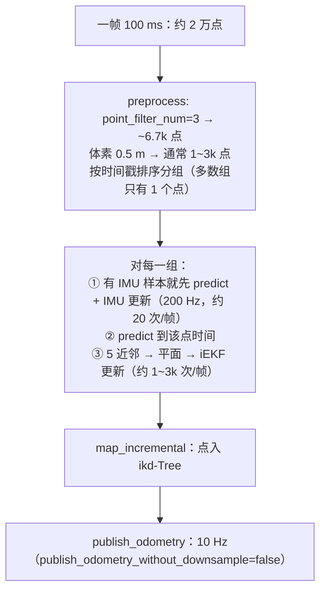

> ## 一、本文所有数值都以本机实际代码/配置为准，不是凭印象写的：

> | 代码       | 位置                                             | 用到的文件                                                                                                                                                                                                                               |
> | ---------- | ------------------------------------------------ | ---------------------------------------------------------------------------------------------------------------------------------------------------------------------------------------------------------------------------------------- |
> | Point-LIO  | `~/point_lio/src/9000_point_lio_ros2_Mid-360/` | `config/mid360.yaml`、`launch/mapping_mid360.launch.py`、`src/laserMapping.cpp`、`src/Estimator.cpp`、`src/Estimator.h`、`src/parameters.cpp`、`include/common_lib.h`、`include/IKFoM/IKFoM_toolkit/esekfom/esekfom.hpp` |
> | Livox 驱动 | `~/livox_ws/src/livox_ros_driver2/`            | `launch_ROS2/msg_MID360_launch.py`、`src/comm/comm.h`、`src/comm/pub_handler.cpp`、`src/lddc.cpp`                                                                                                                                |
> | 本项目     | [./src/lio_naver](./src/lio_naver)                | `src/global_chassis_odom.cpp`、`src/chassis_odom.cpp`、`launch/*.launch.py`                                                                                                                                                        |

---

# 二、iEKF：原理、实际用途、以及在本项目中的具体形态

## 2.1 一句话定位

> **iEKF = 在"误差状态 + 流形"上跑的扩展卡尔曼滤波；Point-LIO 用它把"IMU 的高频推测"和"雷达的几何观测"按各自的不确定度加权融合。**

它要回答的问题只有一个：

$$
\underbrace{x_{k|k-1}}_{\text{IMU 猜的位姿}},\ \underbrace{P_{k|k-1}}_{\text{猜得有多不准}}
\quad+\quad
\underbrace{(z,\ h(\cdot),\ R)}_{\text{雷达量到的"我离墙多远"}}
\;\Longrightarrow\;
\underbrace{x_{k|k},\ P_{k|k}}_{\text{融合后的位姿与不确定度}}
$$

"误差状态"和"流形"是两个工程上必须的细节，下面分开说。

## 2.1.1 为什么用"误差状态"（error-state）而不是直接估计状态

直接对姿态 $R\in SO(3)$ 做 $R+\Delta R$ 会立刻破坏正交性（$R$ 不再满足 $R^{\mathsf T}R=I$），几步之后数值就烂了。误差状态的做法是：

$$
x=\hat x\ \boxplus\ \delta x,\qquad
R=\hat R\,\mathrm{Exp}(\delta\theta)
$$

- 滤波器真正估计的是**小量** $\delta x$（位置误差、姿态误差、速度误差、零偏误差……）；
- 更新完再"加回去"：$\hat x\leftarrow \hat x\boxplus\delta x$。这一步在 IKFoM 里就是 `x_.boxplus(dx_)`；
- $\delta\theta$ 一直保持很小，$\mathrm{Exp}(\cdot)$ 的线性化误差可忽略，而且旋转永远合法。

> 代码里所有状态都通过 MTK 生成的 `boxplus / boxminus` 操作，**不要手写 `+`** —— 对 SO(3) 和 S2（重力方向）来说 `+` 是错的。

### 2.1.2 为什么用"流形"（manifold）

- 姿态在 $SO(3)$：3 个自由度但 9 个参数，只能靠 $\mathrm{Exp}/\mathrm{Log}$ 在切空间里做加减；
- 重力方向在 $S^2$：模长固定为 $g$，只有 2 个自由度（本仓库用 `MTK::S2<double, 98090, 10000, 1>` 近似）。

这两处如果按普通向量处理，会出现"重力模长被优化成 9.3"这种物理上不成立的结果。

## 2.2 预测：一步之内状态怎么走（对应 `get_f_output`）

本配置 `use_imu_as_input: false`，状态是 30 维，顺序为（与 `state_output` 的定义严格一致）：

| 下标   | 含义                         | 记号       |
| ------ | ---------------------------- | ---------- |
| 0–2   | 位置                         | $p$      |
| 3–5   | 姿态（SO(3)）                | $R$      |
| 6–8   | LiDAR-IMU 外参旋转           | $R_{LI}$ |
| 9–11  | LiDAR-IMU 外参平移           | $t_{LI}$ |
| 12–14 | 速度                         | $v$      |
| 15–17 | **角速度（状态量！）** | $\omega$ |
| 18–20 | **加速度（状态量！）** | $a$      |
| 21–23 | 重力（S2）                   | $g$      |
| 24–26 | 陀螺零偏                     | $b_g$    |
| 27–29 | 加计零偏                     | $b_a$    |

`Estimator.cpp::get_f_output` 给出的连续时间导数是：

$$
\dot p=v,\qquad
\dot R=R\,[\omega]_\times,\qquad
\dot v=R\,a+g,\qquad
\dot\omega=\dot a=\dot g=\dot b_g=\dot b_a=0
$$

所以一个 $\Delta t$ 的预测就是：

$$
\begin{aligned}
p&\leftarrow p+v\,\Delta t\\
R&\leftarrow R\,\mathrm{Exp}(\omega\,\Delta t)\\
v&\leftarrow v+(R\,a+g)\,\Delta t\\
\omega,a,g,b_g,b_a&\leftarrow \text{不变（随机游走，靠 }Q\text{ 涨不确定度）}
\end{aligned}
$$

协方差传播是标准的：

$$
P\leftarrow F\,P\,F^{\mathsf T}+Q,\qquad F=\frac{\partial f}{\partial \delta x}
$$

代码里把这两件事拆成两次调用以省时间：

```cpp
kf_output.predict(dt,     Q_output, input_in, true,  false);  // 只推状态
kf_output.predict(dt_cov, Q_output, input_in, false, true );  // 只推协方差
```

> **这就是"IMU 猜"的确切含义**：预测用的是**状态里估计的 $\omega$ 和 $a$**，**不是** IMU 的原始读数。
> 原始读数在下一步作为"量测"进来。这个设计是 Point-LIO 抗 IMU 饱和的关键（见 2.5）。

**$Q$ 的实际构成**（`process_noise_cov_output`）——只有 5 个块非零：

| 块         | 参数               | 本配置值                |
| ---------- | ------------------ | ----------------------- |
| 速度       | `vel_cov`        | 20（YAML 未设，用默认） |
| $\omega$ | `gyr_cov_output` | **1000.0**        |
| $a$      | `acc_cov_output` | **500.0**         |
| $b_g$    | `b_gyr_cov`      | 1e-4                    |
| $b_a$    | `b_acc_cov`      | 1e-4                    |

两个上千的数不是笔误：$\omega$ 和 $a$ 被建模成"随机游走"，每 5 ms 都允许它们大幅变动，紧接着就用 IMU 量测把它们钉回去。**如果把它们调小，$\omega,a$ 会过度平滑、转弯响应变慢。**

> 另有一个实现细节：这份 $Q$ **不乘 $\Delta t$**（标准离散化应是 $Q_d\approx F Q_c F^{\mathsf T}\Delta t$）。
> 好处是调参直观（数值就是"每步涨多少"），代价是**换 IMU 频率（`imu_time_inte`）或换帧率时，滤波器的松紧会跟着变**。本项目频率固定，影响有限，但要知道这个前提。

## 2.3 更新：一次迭代的四个公式（对应 `esekfom.hpp::update_iterated_dyn_share_modified`）

$$
\begin{aligned}
K &= P H^{\mathsf T}\left(H P H^{\mathsf T}+R\right)^{-1} &&\text{（增益）}\\
\delta x &= K\,z && z=\text{量测残差}\\
\hat x &\leftarrow \hat x\ \boxplus\ \delta x &&\text{（流形上加回去）}\\
P &\leftarrow P-K H P &&\text{（协方差收缩）}
\end{aligned}
$$

源码逐行对应：

```cpp
PHT  = P_.block<n,12>(0,0) * h_x.transpose();   // P Hᵀ（只前 12 维参与，见下）
HPHT = h_x * PHT.topRows(12);                   // H P Hᵀ
for (m...) HPHT(m,m) += m_noise;                // + R（标量，各向同性）
K_   = PHT * HPHT.inverse();
dx_  = K_ * z;
x_.boxplus(dx_);
P_   = P_ - K_ * h_x * P_.block<12,n>(0,0);      // P - K H P
```

**为什么只取前 12 维**：`h_x` 是 $1\times 12$，说明这个量测只和误差状态的前 12 维（位置 3 + 姿态 3 + 外参 6）有关。速度、零偏、重力**不直接**被雷达量测约束，只能通过 $P$ 里的互相关间接被修正。

**$R$（量测噪声）在这里是一个标量**：`m_noise = laser_point_cov = 0.01`，被加到 `HPHT` 的每条对角线上。也就是说：

- 所有点、所有距离都用同一个噪声方差（**不随距离增长**，而实际测距误差是随距离增长的）；
- 量纲上它已经在"米²"里（残差是米）。

## 2.4 雷达量测：残差与雅可比（对应 `h_model_output`）

对选中点 $i$（body 系坐标 $p_i$，世界系 $p_i^W=R_{WB}p_i+t_{WB}$），用 5 近邻拟合出平面 $n^{\mathsf T}x+d=0$：

$$
z_i=-\bigl(n^{\mathsf T}p_i^W+d\bigr)=-\underbrace{\text{点到平面的有符号距离}}_{r_i}
$$

$$
H_i=\Bigl[\ \underbrace{n^{\mathsf T}}_{3},\ \underbrace{\bigl(p_i\times(R_{WB}^{\mathsf T}n)\bigr)^{\mathsf T}}_{3},\ \underbrace{0\cdots0}_{6}\ \Bigr]
$$

第二块正是代码里的 `A`：

```cpp
V3D C(s.rot.conjugate().normalized() * norm_vec);   // C = R_WBᵀ n
V3D A(point_crossmat * C);                          // A = [p_i]× C
ekfom_data.h_x.block<1,12>(m,0) << norm_vec(0), norm_vec(1), norm_vec(2),
                                   VEC_FROM_ARRAY(A), 0,0,0,0,0,0;
```

（推导：右扰动 $R\leftarrow R\,\mathrm{Exp}(\delta\theta)$ 时 $\partial r_i/\partial\delta\theta = \bigl(p_i\times(R^{\mathsf T}n)\bigr)^{\mathsf T}$。）

**注意 $z$ 带负号**：$z=-r$，于是 $\delta x=Kz$ 的方向是"把点拉回平面"，而不是推开。

`extrinsic_est_en: true` 时后 6 列才非零（对外参旋转/平移求导）；本配置是 `false`，所以**外参完全不被估计**，这一点在第 3 章是一个改进项。

## 2.5 IMU 量测：残差、雅可比与饱和门控（对应 `h_model_IMU_output`）

$$
z_{IMU}=\begin{bmatrix}\omega_{IMU}-\omega-b_g\\ a_{IMU}\cdot \frac{G}{acc\_norm}-a-b_a\end{bmatrix}_{6\times1}
$$

$$
H_{IMU}:\quad \partial z/\partial\omega=I_3,\quad \partial z/\partial b_g=-I_3,\quad
\partial z/\partial a=I_3,\quad \partial z/\partial b_a=-I_3
$$

代码里体现为"取两个列块相加"：

```cpp
PHT.col(l_)  = P_.col(15+l_) + P_.col(24+l_);   // 对 ω 与 b_g
HPHT.col(l_) = HP.col(15+l_) + HP.col(24+l_);
```

**饱和门控**（`check_satu: true`）：若某轴 $|\omega|\ge 0.99\,satu\_gyro$（34.9 rad/s）或 $|a|\ge 0.99\,satu\_acc$（78.5 m/s²），就把该轴残差置 0、且该列不进入 $K$。

> 这才是"IMU 猜、雷达纠正"能扛高机动的真正原因：
> 预测用的是**状态里的 $\omega,a$**（不是读数），所以某个轴饱和了，只是"这一轴暂时没有量测"，$\omega,a$ 继续按上一次的估计往前推，**不会把饱和的假值直接积进姿态**。

## 2.6 为什么叫"迭代"，而本仓库为什么只跑 1 轮

`update_iterated_dyn_share_modified` 的结构是标准的 Gauss-Newton 迭代：

```
for k in 0..max_iter-1:
    重新算 h(x_k)、H(x_k)      ← 会重新把点投到世界系、重新找 5 近邻、重新拟合平面
    δx = K (z - h(x_k))
    x ← x ⊞ δx
```

迭代的好处：点-面残差是强非线性的（近邻会变、法向会变），一次线性化在**预测已经很接近**时够用，在大误差时不够。

**当前实现（2026-10-24 起）**：

- `esekfom.hpp` 新增了公开接口 `set_maximum_iter(int)` / `get_maximum_iter()`；`init_dyn_share_modified*()` 仍然把 `maximum_iter` 重置为 1（保持库的向后兼容），
- Point-LIO 通过 ROS 参数 `max_iter`（默认 2）在 init 之后设置，并对 `kf_input`、`kf_output` 都生效；
- 启动日志会打印 `IEKF maximum_iter = N`，可直接核对；
- 迭代次数为 1 时行为与原实现**完全一致**（下面那条协方差保护在 `i == maximum_iter-1` 时恒成立）。

> **一个必要的配套修改**：原实现把 $P$ 的更新写在迭代循环**内部**，迭代 N 次就会对同一个量测收缩 N 次 $P$，且下一轮的 $K$ 基于已收缩的 $P$——这既让协方差过度乐观，也偏离标准 Gauss-Newton（应固定先验 $P$ 迭代状态）。
> 现已改为**只在最后一轮更新协方差**。迭代效果、CPU 代价与实测数据见 2.7。

> 另外要记住：**Point-LIO 相对 FAST-LIO2 的优势来自"每个点用自己的时间戳预测"，不来自"多迭代几轮"。**

## 2.7 本项目里的实际用法（时间线 + 量级）



几个能直接算出来的量级：

| 量                  | 值                                                                             | 依据                                                         |
| ------------------- | ------------------------------------------------------------------------------ | ------------------------------------------------------------ |
| 每帧 LiDAR 更新次数 | ≈ 下采样后点数 ≈ **1~3 千次**                                          | `time_compressing` 按相同时间戳分组，绝大多数组只有 1 个点 |
| 每帧 IMU 更新次数   | ≈ **20 次**（200 Hz × 0.1 s）                                          | 每个 IMU 样本一次                                            |
| 每帧总 K 求解       | 1~3 千次 $n\times m$ 矩阵求逆（$m$=有效点数，通常几十~几百）               | CPU 主要开销                                                 |
| 有效输出位姿        | **10 Hz**；本节点 `publish_rate: 50` 只是把同一帧重复 5 次（零阶保持） | 见 3.2.1                                                     |

**对本项目下游的影响**：

- `/chassis/odom` 的位姿在 100 ms 内是"跳"的（5 个 50 Hz 消息内容完全相同），控制环若按 50 Hz 用，相当于 100 ms 的量化延迟；
- `twist` 也是 10 Hz 更新一次，**不是**每 20 ms 都刷新。

### 2.7.1 本次改动的实测结果（合成数据冒烟测试）

**结论先行**：`point_filter_num` / `max_iter` 的调参必须建立在"点时间戳正确"这个前提上。本轮排查发现该前提原本是**坏的**（见 3.3.8），修好之后各配置的表现才符合预期。

#### (a) 修复前后：单帧更新耗时（静止房间，约 9600 点/帧）

| 配置           | 修复前 `icp`   | 修复后 `icp`   | 说明      |
| -------------- | ---------------- | ---------------- | --------- |
| pf=3（本项目） | **221 ms** | **3.8 ms** | 60× 提升 |
| pf=4           | 19.6 ms          | 1.9 ms           | 10× 提升 |

修复前"点更少反而更慢"，是因为整帧被时间戳 bug 塌缩成一个组，求解复杂度从 O(N) 变成 O(N³)；修复后耗时与点数呈线性关系（578→3.8 ms，294→1.9 ms）。

#### (b) 修复后：精度与耗时（静止 / 匀速 0.3 m/s 各 10 s）

| 配置         | 静止偏移   | 匀速 dy（真值 2.97 m） | 速度估计误差 | 每帧 `icp` |
| ------------ | ---------- | ---------------------- | ------------ | ------------ |
| pf=3, iter=1 | dx=-1.2 mm | 2.9727 m               | +0.0002 m/s  | 7.2 ms       |
| pf=3, iter=2 | dx=+4.0 mm | 2.9780 m               | +0.0008 m/s  | 9.3 ms       |
| pf=4, iter=1 | dx=+0.5 mm | 2.9692 m               | -0.0001 m/s  | 3.9 ms       |
| pf=4, iter=2 | dx=-4.6 mm | 2.9696 m               | -0.0000 m/s  | 5.4 ms       |

结论：

1. **修复后各配置精度都在毫米级，差异属于测试噪声**；`max_iter=2` 在合成数据上**没有**带来精度收益，只增加约 20~40% 耗时。
2. `point_filter_num=4` 比 3 快约 2 倍，精度相当；若实车 CPU 富余，保留 3 可多留一些几何约束。
3. 修复前观察到的"pf=4 + 单次迭代偏 0.20 m"是**塌缩组导致的批次线性化误差**，修复后不复现——那条结论已作废。

> 合成数据是理想平面、无噪声、无运动畸变。真实场景请用第三章的"直行 1–3 m / 原地 180°"判据复验，重点看：静止抖动、直行残差、CPU 占用。

## 2.8 噪声参数怎么影响行为（调参直觉）

| 参数                                        | 现值        | 调大                                                     | 调小                                        |
| ------------------------------------------- | ----------- | -------------------------------------------------------- | ------------------------------------------- |
| `lidar_meas_cov`                          | 0.01        | 更信 IMU → 平滑、转弯滞后、退化时更"跟着惯性走"         | 更信雷达 → 跟得紧、容易受噪点/动态物体影响 |
| `imu_meas_omg_cov` / `imu_meas_acc_cov` | 0.01 / 0.01 | 更信状态里的 $\omega,a$ → 对 IMU 噪声不敏感、但响应钝 | 更信 IMU 读数 → 响应快、抖动大             |
| `gyr_cov_output` / `acc_cov_output`     | 1000 / 500  | $\omega,a$ 更"自由" → 更依赖 IMU 量测钉住             | 更平滑，但高机动时跟不上                    |
| `b_gyr_cov` / `b_acc_cov`               | 1e-4        | 零偏允许漂 → 温漂场景更好                               | 零偏更稳 → 但真实零偏漂移会变成姿态误差    |
| `vel_cov`                                 | 20          | 速度更自由 → 更信任加速度计                             | 速度更平滑                                  |
| `plane_thr` / `match_s`                 | 0.1 / 81    | 更宽松 → 更多点参与、但可能混入坏平面                   | 更严格 → 点少、退化时更容易没有量测        |
| `filter_size_surf` / `filter_size_map`  | 0.5 / 0.5   | 更快、更稀（室内偏粗）                                   | 更准、更慢                                  |

> 一条经验：**先别动噪声，先确认"有效点数"。** 如果每帧只有几十个点通过平面筛选（比如贴着墙、或者被载荷挡住），再调噪声也不会好——那叫几何退化，见 3.1.3。

## 2.9 iEKF 的能力边界（它治不了什么）

| 它能做                          | 它不能做                                         |
| ------------------------------- | ------------------------------------------------ |
| 在 IMU 与雷达之间按不确定度加权 | **纠正累积漂移**（没有回环、没有全局优化） |
| 在线估计零偏、重力方向          | **识别"我来过这里"**（无重定位）           |
| 输出协方差（供下游加权）        | 保证协方差准确（见 3.2.5，实际偏乐观）           |
| 逐点解释运动（无去畸变环节）    | 处理动态物体（会被当静态点写进地图）             |
| 对退化给出"量测少"的隐含信号    | **显式检测退化并告警**（当前没有实现）     |

一句话：**iEKF 是"局部最优的融合器"，不是"全局的定位系统"。** 第 3 章的所有改进，本质上都是在补它做不到的那一半。

---

# 三、现有方案的缺点与改进方向

按"影响大小 × 改动成本"排序。每条都给出**可验证的现象**与**验收判据**，避免停留在"应该改"。

## 3.1 精度与鲁棒性

### 3.1.1 没有回环 / 没有先验地图 / 每次开机原点不同（**影响最大**）

- **现象**：`map` 原点 = 开机瞬间的底盘中心（`anchor`）。每次重启，同一个物理位置的坐标都不一样；绕场地一圈回到起点，末端有累积偏差。
- **为什么是问题**：比赛场地是**固定**的，任务点理应能用固定坐标描述。现在每场比赛都要重新"找起点"，任何依赖绝对坐标的任务规划都被废掉。
- **改进**（按成本递增）：
  1. **持久化地图 + 启动重定位**（性价比最高）：
     - 跑一遍场地，`pcd_save_en: true` 存下地图；
     - 启动时加载 PCD → 用 NDT/ICP 与当前帧求初始位姿 → 把 `anchor` 设成该位姿（**不要**再置零）；
     - 这样 `map` 就是场地的固定坐标，也顺带让 3.1.2 的尺度可以对着"已知场地尺寸"核对。
  2. **回环检测 + 位姿图优化**：关键帧 + Scan Context 描述子 → 回环 → GTSAM/Ceres 优化 → 更新地图。工作量约 2–3 周，收益是长距离漂移被"拉回"。
- **验收**：连续两次开机、在同一物理点静止，`/global/chassis_odom` 的差值 ≤ 5 cm / 1°。

### 3.1.2 系统性尺度偏差 ≈ +1.7%

- **现象**：`chassis_odom.launch.py` 的标定记录——2 m 走成 2.036 m（+1.8%），3 m 走成 3.048 m（+1.6%）。5 m 就是 8.5 cm，20 m 就是 34 cm。
- **影响**：任何"走到固定坐标"的任务都会系统性走过头。
- **重要**：**`mount_*` 修不了尺度**（纯平移时 $t_{BC}$ 被消掉，`mount_yaw/roll` 只改方向不改长度）。所以必须找根因。
- **定位手段（按顺序做，能一次分清责任方）**：

  | 测试                   | 做法                                               | 若偏差大说明                          |
  | ---------------------- | -------------------------------------------------- | ------------------------------------- |
  | **静态测距**     | 车不动，正前方 5 m / 10 m 放板，读点云距离 vs 卷尺 | 雷达测距/安装外参问题（与融合无关）   |
  | **长直线**       | 10 m 直线（地面贴基准/导轨），读终点 Δy vs 卷尺   | 时间同步/尺度融合问题                 |
  | **原地转 360°** | 读终点是否回到原点                                 | 纯旋转漂移（权重小，但能看 IMU 质量） |
  | **往返闭环**     | 5 m 去 + 5 m 回                                    | 往返不对称 → 单侧系统性误差          |
- **候选根因**（按可能性排序）：

  1. **时间戳的"比例"误差**：`time_lag_imu_to_lidar: 0.0` 未标定。时间偏移在运动中等价于"尺度/方向"误差。→ 用 LI-Init 或"同一段路扫不同 lag"的搜索来标。
  2. **点时间戳量化**：`curvature` 单位是 ms，且 `preprocess.cpp` 里有一段"时间跳变 > 1 ms 就用 4.166667 ms 兜底"的逻辑（`pl_full[i-1].curvature + 0.004166667f`）。若驱动时间戳有跳变，这段兜底会**系统性改写点时间**，直接造成畸变补偿偏差。
  3. **`acc_norm` / IMU 标度**：当前 9.81（认为读数是 m/s²）。若实际是 g 或有比例误差，重力模长就错。
  4. **地面基准本身**：手推 3 m 时车头自转会让路径弯曲，用"端点直线距离"当基准会有 0.5% 量级误差。
- **验收**：10 m 直线往返，$\Delta y/10$ 的残差 ≤ 0.3%，且往返一致。

### 3.1.3 几何退化没有任何检测（**比赛场景高风险**）

- **现象**：`h_model_output` 只做"残差阈值"筛选；没有对 $H^{\mathsf T}H$ 的特征值/条件数做判断，也没有"有效点数"话题。长廊、空旷处、正对单面墙时，位姿会**静默地漂**，日志里看不出异常。
- **本项目特有风险**：机器人**搬运/推举物体**时，载荷会占据雷达视场的一大块（尤其顶装、前装），有效平面骤减——正好发生在任务关键阶段。
- **改进**：
  1. 统计每帧 `effct_feat_num`（代码里已有这个全局变量）→ 发布 `/lio/health`（有效点数、平均残差、饱和标志、匹配耗时）；
  2. 用 $H^{\mathsf T}H$ 的最小特征值/条件数做退化检测（X-ICP / LIO 里的标准做法）；
  3. 退化时：降权对应方向的雷达量测、增强 IMU 权重，并给下游一个"当前不可信"的告警；
  4. 长期：加轮速（见 3.1.4）或第二颗雷达。
- **验收**：把车贴在单一墙面前方 1 m 静止/直行，能稳定输出 "degenerate" 告警。

### 3.1.4 无轮速/底盘反馈（单传感器，无冗余）

- **现象**：整个系统只有 LiDAR + 内置 IMU。代码里没有任何编码器/轮速接口（`rg -i "wheel|encoder" src/` 为空）。
- **影响**：打滑、被推、载荷遮挡、雷达脏污时**没有第二信源**；低速直行时雷达几何约束弱（位移小），而轮速恰恰在低速很准。
- **改进**：融合轮速（一维），成本很低：
  - 在 `global_chassis_odom` 里加一路"轮速预测量"，做 4 维 EKF（$x,y,\theta,v$）与 LIO 位姿松耦合；
  - 或把轮速作为 `twist` 直接替换（仅直行段），并发布状态标志；
  - 严格做法：在 Point-LIO 里加 wheel 因子（紧耦合），工作量大。
- **验收**：遮挡雷达 2 s（用手挡），输出位置不跳变 > 10 cm。

### 3.1.5 动态物体污染地图

- **现象**：`map_incremental()` 把当前帧**所有**通过筛选的点写进 ikd-Tree，没有可见性/一致性检查。
- **影响**：走动的人、移动的箱子会在墙上"叠出"一层假平面；后续帧拿它当参照 → 位姿被拉偏。比赛现场有人走动是常态。
- **改进**：
  1. 廉价方案：只把"在自由空间里孤立"的点剔除（点到已有地图的最近距离 + 法向一致性双重判据）；
  2. 中等方案：Removert / ERASOR 式的可见性剔除（把地图点投到当前帧，若落在"应该能看到但没看到"的方向就删除）；
  3. 保守方案：只在启动后前 N 秒建图，之后冻结地图（`cube_side_length` 改小 + 停止 `map_incremental`）。
- **验收**：一个人绕车走 2 圈，回到起点位置误差 ≤ 5 cm。

### 3.1.6 外参固定、离线标定，且不易复核

- **现象**：`extrinsic_est_en: false`；`mount_*`/`lidar_*`/`trim_*` 全部是常量。
- **影响**：碰撞/拆装后外参变了不会被发现；`mount_yaw=58°` 这种大角度安装一旦松动，所有输出全歪。
- **改进**：
  1. 短期：启动时比较 `T_BC` 与最近一次标定值的差，超阈值告警；
  2. 中期：打开 `extrinsic_est_en`（需要充分激励，静止时不可观，**不要**只拿直行数据打开）；
  3. 长期：用 LI-Init 做 LiDAR-IMU 外参与时间偏移的联合标定，值写进 YAML 而不是 launch。
- **验收**：人为把雷达偏转 2°，系统能告警（而不是静默地把误差吃进轨迹）。

### 3.1.7 时钟一致性（雷达时钟 vs ROS 时钟）

- **现象**：`/aft_mapped_to_init.header.stamp` 用的是**雷达内部时钟**（`get_ros_time(lidar_end_time)`，来源是 `Measures.lidar_beg_time` ← 驱动 `pkg.base_time`）；而节点里静态 TF 用的是 `this->now()`（`publishStaticTransforms`）。
  - 实测：CSV 时间戳 `1791011916.785` 对应 `2026-10-03 15:18:36`，与文件 mtime 一致 → **当前雷达时钟是对齐主机 epoch 的**；
  - 但主机上**没有** `ptp4l` / `phc2sys`（`systemctl is-active` 均为 inactive，二进制也不存在），所以这个对齐的来源与稳定性没有保障。
- **影响**：一旦两者出现固定偏移，`tf2::Buffer::lookupTransform(..., now())` 会报 extrapolation；混用两种时钟做时间对齐的下游会算错。
- **改进**：
  1. 启动时打印"雷达时间 − ROS 时间"的差值并周期性监控（> 20 ms 告警）；
  2. 统一时钟：要么全部用雷达时间（TF 也用同一个 stamp），要么启用 PTPv2（`linuxptp`，雷达作 slave）；
  3. 至少把静态 TF 的 stamp 从 `now()` 改成与输入一致的时钟。
- **验收**：`ros2 run tf2_ros tf2_echo map base_link` 连续 10 min 不报 extrapolation。

### 3.1.8 必须静止初始化

- **现象**：`start_in_aggressive_motion: false`；`IMU_init` 要 100 个 IMU 样本（≈0.5 s）求平均重力和零偏；本节点还要 `anchor_samples=10`（10 Hz → 1 s）静止样本。
- **影响**：开机后约 1.5 s 内不能动；若在动，重力和零偏会被估歪，且 `anchor` 是"运动中的平均起点"，整条轨迹带恒定偏差。
- **改进**：
  1. 若场地水平已知，用 `start_in_aggressive_motion: true` + 给定 `gravity_init`，跳过静止要求；
  2. 或统一发令：车推到起点、静止 2 s 再开始；
  3. 本节点侧：`anchor` 完成前不发布（已实现），但**要给出显式状态**（如 `/lio/ready` 布尔话题），让下游自动等待，而不是靠人看日志。
- **验收**：开机即推车（模拟违规操作），系统能提示"初始化不稳定，建议重启"，而不是静默输出错误轨迹。

## 3.2 实时性与输出质量

### 3.2.1 有效位姿只有 10 Hz，50 Hz 输出是"零阶保持"

- **现象**：`publish_odometry_without_downsample: false` → Point-LIO 每帧（100 ms）发一次 odom。`global_chassis_odom` 的 `publish_rate: 50` 只是用定时器把**同一个** `output_` 重复发布 5 次，`stamp_` 也不变。
- **影响**：
  - 控制环拿到的位姿每 100 ms 才更新，其余 4 条消息完全相同 → 相当于 100 ms 的量化延迟；
  - `twist` 同样是 100 ms 的阶梯；
  - 轨迹/CSV 里会看到大量重复行。
- **改进**（不要直接把 `publish_odometry_without_downsample` 改成 true）：
  - 那个开关是"**每处理一组点发一次**"，实测会到**上万 Hz**，TF 会被灌爆；
  - A：在 `global_chassis_odom` 里订阅 `/livox/imu`，用最近一次 LIO 位姿做"IMU 短时外推"，在 50/100 Hz 输出平滑位姿（协方差随时间增长）；
  - B：在 Point-LIO 里新增"按 IMU 频率发布"的开关（预测后发布、不更新地图），改动小但要测 CPU；
  - C（最省事）：下游只按 10 Hz 用，并显式做延迟补偿（用 `stamp` 而不是 `now`）。
- **验收**：控制环 50 Hz 收到的位姿差分与 `/livox/imu` 积分一致（100 ms 内残差 < 1 cm）。

### 3.2.2 逐点更新的 CPU 成本

- **现象**：每帧 1~3 千次"预测 + 5 近邻搜索 + 平面拟合 + K 求解"，且 `max_iter=2` 会让 LiDAR 更新做两轮（第二轮同样重算投影与近邻）。
- **影响**：单核占用上升；若同时跑 RViz / 记录 / 打印节点，容易掉帧（表现为 `/aft_mapped_to_init` 频率 < 10 Hz）。
- **现状（2026-10-24）**：`point_filter_num` 保持 **3**、`max_iter` = **2**；修好点时间戳 bug 后（3.3.8），pf=3 的单帧更新耗时从 221 ms 降到 **3.8 ms**，`max_iter` 1→2 约再增加 20~40%（见 2.7.1）。
- **后续可调**：
  - `point_filter_num` 4 → 5（再降 20%）；
  - `filter_size_surf` 0.5 保持不变（再大更稀）；
  - `scan_line` 不要动（对 Mid-360 调小只会"静默丢点"）；
  - 关闭不需要的输出（`path_en`、`scan_publish_en`），减少序列化开销。
- **验收**：`top -H` 看 `pointlio_mapping` 单核 < 80%，`ros2 topic hz /aft_mapped_to_init` 稳定 10 Hz。

### 3.2.3 主循环 5 kHz 空转

- **现象**：`laserMapping.cpp` 主循环是 `rclcpp::Rate rate(5000)` + `executor.spin_some()` + `rate.sleep()`，即**每 0.2 ms 醒一次**看有没有新数据。
- **影响**：即使没有数据也持续占一个核（`spin_some` + 睡眠抖动），与逐点更新开销叠加。
- **改进**：改成事件驱动（代码里已有 `sig_buffer` 条件变量与 `mtx_buffer`，具备条件）；至少把频率降到 200–500 Hz。
- **验收**：无雷达数据时进程 CPU < 5%。

### 3.2.4 体素 0.5 m 对室内小场景偏粗

- **现象**：`filter_size_surf = filter_size_map = 0.5`（官方给大场景的值）。一帧 2 万点在 0.5 m 体素里被压到 1~3 千点，室内墙面上非常稀疏。
- **影响**：平面法向估计精度下降（5 个近邻可能跨 1 m 以上）、小物体/窄通道的几何丢失。
- **改进**：室内小场地试 `0.2~0.3`；改完必须复看 CPU 与 `ros2 topic hz`。
- **验收**：静止抖动（1 s 标准差）< 5 mm / 0.1°；直行 3 m 横向残差不变差。

### 3.2.5 协方差实际是"全零"，`copy_covariance` 在骗自己

- **现象**：`publish_odometry()` 里协方差只在 `if (odom_only)` 分支填（那会发到 `/odom_corrected`）。本项目 `odom_only` 默认 `false`，所以 `odomAftMapped.pose.covariance` / `twist.covariance` **保持全 0**。→ 本节点 `copy_covariance: true` 复制过去的也是全零。
- **影响**：下游若用协方差做加权/门限，会认为"位姿绝对精确"，反而放大错误（比不提供更糟）。
- **改进**：
  1. 最省事：`copy_covariance` 设为 `false`，明确"不提供协方差"；
  2. 正确做法：在 `publish_odometry` 里无条件从 `kf_output.get_P()` 导出位置块（姿态块按 $RPR^{\mathsf T}$ 传播到底盘系）；
  3. 注意逐点更新会让 $P$ 在一帧内收缩上千次，名义协方差**偏乐观**（2.9 提到的边界）。
- **验收**：`ros2 topic echo /global/chassis_odom --field pose.covariance` 非零，且静止时对角线随时长**下降**、运动时**上升**。

## 3.3 工程与可维护性

### 3.3.1 两套 odom 节点高度重复

- **现象**：`src/chassis_odom.cpp`（332 行）与 `src/global_chassis_odom.cpp`（478 行）去空白后唯一非空行中有 **179 行完全相同**（`comm -12` 统计）。核心变换、anchor、twist 换算是同一份逻辑的两份拷贝。
- **影响**：修一个 bug 要改两处；两份参数名还不完全一致（`chassis_frame_id` vs `map_frame_id`），容易配错。
- **改进**：合并为一个节点，用参数选择模式：
  - `output_mode: relative`（等价旧 `chassis_odom`：父系 `chassis_init`，anchor 归零）
  - `output_mode: global`（父系 `map`，叠加 $A$ 偏置）
    旧 launch 保留为薄封装（只改参数），外部脚本不破。
- **验收**：旧 CSV 的 17 项断言在新节点上全过；launch 文件数从 3 减到 2。

### 3.3.2 `body_frame_id` 默认值与 Point-LIO 实际帧名不匹配

- **现象**：`global_chassis_odom.cpp` 里 `body_frame_id` 默认 `"body"`；而 Point-LIO 的 `odom_child_frame_id` 默认 `"aft_mapped"`（`parameters.cpp:40`，本 fork 未覆盖），TF 里发的也是 `camera_init → aft_mapped`。
- **影响**：一旦打开 `publish_base_link_to_body_tf: true`，会发出 `base_link → body`，**和 `camera_init → aft_mapped` 完全接不上**（两个不同的 frame 名），TF 树依旧断开，而日志只会提示"请确认没有多父系"。
- **改进**：默认值改成 `aft_mapped`，或启动时校验该 frame 是否真的存在于 TF 树里（不存在就 WARN）。
- **验收**：`ros2 run tf2_ros tf2_echo base_link aft_mapped` 能出结果。

### 3.3.3 `blind` 的括号优先级 bug（2026-10-24 已修复）

- **现象（修复前）**：`preprocess.cpp` 的 Livox 分支：

  ```cpp
  if ((abs(x - x_prev) > 1e-7) || (abs(y - y_prev) > 1e-7)
      || (abs(z - z_prev) > 1e-7) && (x*x + y*y + z*z > blind*blind))
  ```

  C++ 里 `&&` 优先级高于 `||`，实际语义是：

  ```
  (dx>eps) OR (dy>eps) OR (dz>eps AND range>blind)
  ```

  → **只要 x 或 y 变了（几乎总成立），近距点照样保留**；`blind` 只对"x、y 都没变、z 变了"的点起作用。
- **影响**：

  - `blind=0.1` 基本没生效。好在 Mid-360 硬件盲区本来就是 0.1 m，本项目**几乎无感**；
  - 但如果雷达装得贴着车体、或对着自己的结构件，近距离返点会进入地图并造出假平面；
  - 这个条件还兼着"去重复点"的作用（完全相同坐标的点被丢弃），改的时候别把这个功能弄丢。
- **修复后**（`src/preprocess.cpp`，与 velodyne/unilidar 分支判据一致）：

  ```cpp
  const float range2 = pl_full[i].x * pl_full[i].x +
                       pl_full[i].y * pl_full[i].y +
                       pl_full[i].z * pl_full[i].z;
  const bool moved =
      (std::fabs(pl_full[i].x - pl_full[i - 1].x) > 1e-7f) ||
      (std::fabs(pl_full[i].y - pl_full[i - 1].y) > 1e-7f) ||
      (std::fabs(pl_full[i].z - pl_full[i - 1].z) > 1e-7f);
  if (moved && range2 > blind * blind) pl_surf.push_back(pl_full[i]);
  ```
- **验证**：把新旧判据抽成独立小程序跑 7 组用例，全部符合预期（近距点由"保留"变为"丢弃"、完全重复点仍被去重、0.0999 m 边界丢弃、0.1001 m 保留），正常点数量不受影响。
- **验收（实车）**：若雷达贴近车体，观察 RViz 中自车周围不再出现贴脸的假平面。

### 3.3.4 参数硬编码 / 绝对路径

- **现象**：launch 里写了 `/home/qcver/laser/global_chassis_log.csv`、`map_x=0.663, map_y=0.875, map_z=0.15` 等机器/场地相关常量；标定值也都堆在 launch 的注释里。
- **影响**：换机器、换场地、换场地坐标 → 改 launch；注释里的标定历史与代码混在一起，容易与 YAML 不同步。
- **改进**：
  1. 参数抽到 `config/lio_naver.yaml`（`csv_path` 用 `${HOME}` 或环境变量）；
  2. 标定结果单独一份 `config/calib.yaml`，由标定脚本自动写入；
  3. launch 只留"选哪份配置"。
- **验收**：新机器 `git clone` 后只改 `calib.yaml` + `site.yaml` 就能跑。

### 3.3.5 没有测试入库

- **现象**：readme 提到的"离线合成数据脚本、17 项断言"**没有纳入仓库**（`find . -iname "*test*"` 为空）。
- **影响**：每次改坐标逻辑只能靠实车验证；而这次改动（`trim_*` 符号、`t_BC` 的旋转）恰恰最容易错。
- **改进**：把合成数据脚本做成 `launch_testing` / `pytest`：
  - 喂固定位姿序列（静止 → 直行 3 m → 原地 180° → 360°）；
  - 断言输出点、TF、twist；
  - `colcon test` 一键跑。
- **验收**：`colcon test --packages-select lio_naver` 通过。

### 3.3.6 没有健康监控与诊断

- **现象**：只有"上游停发 > 1 s 给 WARN"和首条消息 frame 校验；没有 `/diagnostics`，没有输入频率/延迟/有效点数/退化/时钟差监控。
- **影响**：现场"看起来在跑，其实在漂"是最难排查的故障模式。
- **改进**：一个 `diagnostic_updater` 就够，发布：输入频率、有效特征数、时钟差、TF 最长延迟、anchor 状态、退化标志。

### 3.3.7 双 launch 并存带来的互斥风险

- **现象**：`chassis_odom.launch.py` 与 `global_chassis_odom.launch.py` 同时运行且都发 TF 时，`base_link` 会有两个父系（readme 已警告，但没有代码级保护）。
- **改进**：两个节点启动时检查 `base_link` 是否已在 TF 树里；若存在则拒绝发 TF 并明确报错。

### 3.3.8 点时间戳被错误改写，整帧塌缩成一个时间组（2026-10-24 已修复）

- **现象（修复前）**：`preprocess.cpp::avia_handler` 里

  ```cpp
  pl_full[i].curvature = msg->points[i].offset_time / 1e6;   // 帧内偏移，单位 ms
  pl_full[i].curvature = fabs(curv - pl_full[i-1].curvature) < 1.0
                         ? curv
                         : pl_full[i-1].curvature + 0.004166667f;
  ```

  这段"时间戳连续性检查"是上游 FAST-LIO 的写法，它默认 `pl_full[i-1]` 一定被赋值（即 `point_filter_num == 1`）。
  而本项目 `point_filter_num = 3` 时，**i-1 这个索引有 2/3 的概率没被赋值，其 curvature 保持初值 0**，于是：

  - 帧内偏移 ≥ 1 ms 的点（几乎整帧）都走 else 分支 → 统一变成 `0 + 0.0041667 ms`；
  - `time_compressing` 按"curvature 相同"分组 → **3199 个点里有 3168 个落进同一个组**（Python 复现预处理逻辑得到的确切数字）。
- **影响（比看上去严重）**：

  1. **逐点更新退化为"整帧一次更新"**：所有点被当作在 `t≈0` 时刻测得，完全丢失帧内 100 ms 的运动补偿（Point-LIO 的看家本领）；
  2. **求解复杂度从 O(N) 变成 O(N³)**：量测矩阵是 $N\times N$（$N$≈该组点数），`HPHT.inverse()` 成本立方增长；
  3. 由此产生的"批次线性化误差"会表现为**静止/低速时也有的固定偏移**，且对 `max_iter` 极其敏感——这就是上一轮"pf=4 + 单次迭代偏 20 cm"现象的真正来源。
- **修复**：以"上一个被保留的点"为参考，保留真实时间戳，只在真正的时间跳变时才兜底：

  ```cpp
  float prev_kept_curv = 0.0f;  bool has_prev_kept = false;
  ...
  const float curv = msg->points[i].offset_time / float(1000000);
  float cur_curv = curv;
  if (has_prev_kept && std::fabs(curv - prev_kept_curv) >= 1.0f)
      cur_curv = prev_kept_curv + 0.004166667f;   // 仅在跳变时前进一个点周期
  pl_full[i].curvature = cur_curv;
  prev_kept_curv = cur_curv;  has_prev_kept = true;
  ```
- **实测（合成数据，静止房间）**：

  | 指标                 | 修复前                      | 修复后                      |
  | -------------------- | --------------------------- | --------------------------- |
  | 每帧分组数（pf=3）   | **32**（最大组 3168） | **3199**（每组 1 点） |
  | 每帧更新耗时（pf=3） | 221 ms                      | **3.8 ms**            |
  | 每帧更新耗时（pf=4） | 19.6 ms                     | **1.9 ms**            |
  | 耗时随点数           | 近似立方                    | **线性**              |
- **验收（实车）**：`ros2 topic hz /aft_mapped_to_init` 稳定 10 Hz，`top` 看 `pointlio_mapping` 占用明显下降；直行 3 m 的尺度/横向残差应优于改动前（建议重跑第三章的标定测试，因为帧内畸变补偿恢复后，历史标定值可能需要复核）。

## 3.4 改进优先级总表

| 优先级       | 改进                                                    | 解决的问题          | 预期收益                                   | 工作量             | 验收判据                  |
| ------------ | ------------------------------------------------------- | ------------------- | ------------------------------------------ | ------------------ | ------------------------- |
| **P0** | 尺度根因定位（静态测距 + 10 m 直线 + lag 标定）         | 3.1.2               | 消除 1.7% 系统偏差，长距离任务可用         | 1–2 天            | 10 m 往返残差 ≤ 0.3%     |
| **P0** | 时钟差监控 + 静态 TF 用同一时钟                         | 3.1.7               | 避免 TF extrapolation 与诡异漂移           | 半天               | 10 min 无 extrapolation   |
| **P0** | 有效位姿延迟补偿（IMU 外推或显式延迟补偿）              | 3.2.1               | 控制环带宽/稳定性明显改善                  | 2–3 天            | 50 Hz 位姿与 IMU 积分一致 |
| **P1** | 持久地图 + 启动重定位                                   | 3.1.1               | `map` 变成固定场地坐标，任务点可预先定义 | 3–5 天            | 两次开机同点误差 ≤ 5 cm  |
| **P1** | 有效点数/退化告警 + `/diagnostics`                    | 3.1.3、3.3.6        | 把"静默漂移"变成"可观测故障"               | 2 天               | 单墙场景稳定告警          |
| **P1** | 轮速融合（低速/遮挡冗余）                               | 3.1.4               | 遮挡、打滑时不再失控                       | 3–5 天            | 遮 2 s 位移不跳 > 10 cm   |
| **P1** | 协方差：修正或关掉                                      | 3.2.5               | 不再给下游"绝对可信"的假信息               | 半天               | 协方差非零且随运动变化    |
| **P2** | 动态点剔除                                              | 3.1.5               | 有人走动时不污染地图                       | 5–10 天           | 人绕 2 圈回原点 ≤ 5 cm   |
| **P2** | 回环检测 + 位姿图                                       | 3.1.1               | 长距离累积误差被拉回                       | 2–3 周            | 绕场一圈闭合误差 ≤ 10 cm |
| **P2** | 节点合并 + 参数外置 + 测试入库                          | 3.3.1、3.3.4、3.3.5 | 后续改动不再"改两处、靠实车验"             | 3–5 天            | `colcon test` 通过      |
| **P2** | `body_frame_id` 修正、5 kHz 降频                      | 3.3.2、3.2.3        | 去掉明确的坑                               | 半天               | 见各自验收                |
| **P3** | `filter_size_*` 0.5 → 0.2/0.3 调参                   | 3.2.4               | 室内精度小幅提升                           | 半天（含实车复测） | 静止抖动 < 5 mm           |
| 已完成       | `blind` 括号修复 / `max_iter=2` / 点时间戳 bug 修复 | 3.3.3、3.3.8、2.6   | 盲区过滤生效；逐点语义恢复，pf=3 快 60×   | —                 | 见 2.7.1、3.3.3、3.3.8    |

## 3.5 建议的落地顺序（三个阶段）

**第一阶段（1 周内，只做"让现状可信可测"）**

1. 尺度根因定位（3.1.2）——唯一一个"改完立刻全盘受益"的项；
2. 时钟差监控 + 静态 TF 时钟统一（3.1.7）；
3. `/diagnostics` + 有效点数告警（3.1.3 / 3.3.6）；
4. 协方差修正或关闭（3.2.5）；
5. `body_frame_id` 修正与 5 kHz 降频（3.3.2 / 3.2.3）。
   （`blind` 修复、`max_iter=2`、点时间戳 bug 修复已于 2026-10-24 完成，见 2.7.1 / 3.3.8。）

这一阶段**不改算法**，只把"看不见的问题"变成"看得见"，后面所有改进才有客观判据。

**第二阶段（2–4 周，解决比赛最痛的两点）**

1. 持久地图 + 启动重定位（3.1.1）——把 `map` 变成固定场地坐标；
2. 位姿延迟补偿（3.2.1）——控制环带宽；
3. 轮速融合（3.1.4）——遮挡/打滑冗余。

**第三阶段（1–2 个月，长远质量）**

1. 动态点剔除（3.1.5）；
2. 回环 + 位姿图（3.1.1）；
3. 工程整理：节点合并、参数外置、测试入库（3.3.1 / 3.3.4 / 3.3.5）。

## 3.6 一句话总结

> 现在这套系统的**局部精度**（静止厘米级、短距 1~2% 尺度）已经够用；
> 真正的短板不是 iEKF，而是它**外面**的三件事：
> **① 没有绝对参考（每次开机原点不同）→ 无法用场地坐标做任务；**
> **② 没有第二信源与退化检测（载荷遮挡即失明）→ 比赛关键阶段最脆弱；**
> **③ 输出只有 10 Hz 且协方差是假的 → 下游拿到的是"看似可靠其实不可靠"的数据。**
> 改进顺序也应照这三点来，而不是先调噪声参数。
